# Modyfikacja obrazów: zwiększanie rozdzielczości i odszumianie

Projekt SIGK. Zrealizowane zadania: **2.1 Zwiększanie rozdzielczości** oraz **2.2 Odszumianie**. Zbiór danych: DIV2K. Implementacja: Python i PyTorch.

## 1. Cel

Celem było zaproponowanie architektury sieci neuronowej i zastosowanie jej do dwóch zadań poprawy jakości obrazu. Wyniki porównano z metodami bazowymi wskazanymi w temacie:

| Zadanie | Warianty | Metoda bazowa |
|---|---|---|
| Zwiększanie rozdzielczości | wejście 32×32 i 64×64, wyjście 256×256 | `cv2.resize`, interpolacja bikubiczna |
| Odszumianie | szum gaussowski σ = 0.01 i σ = 0.03 | `skimage.restoration.denoise_bilateral` |

Jakość oceniano metrykami MSE, PSNR, SSIM i LPIPS na całym zbiorze testowym.

## 2. Dane

### 2.1 Podział zbioru

Użyto obrazów HR z DIV2K. Wszystkie eksperymenty prowadzono na obrazach 256×256, wyciętych z oryginałów w pełnej rozdzielczości.

| Zbiór | Źródło | Sposób wycinania | Liczba obrazów 256×256 |
|---|---|---|---|
| treningowy | DIV2K_train_HR, obrazy 0001–0760 | 16 losowych wycinków na obraz | 12 160 |
| walidacyjny | DIV2K_train_HR, obrazy 0761–0800 | 4 kafelki z regularnej siatki | 160 |
| testowy | DIV2K_valid_HR, obrazy 0801–0900 | pełna siatka kafelków bez nakładania | 3 598 |

Zbiór testowy DIV2K nie ma publicznych obrazów HR, dlatego rolę zbioru testowego pełni oficjalny zbiór walidacyjny DIV2K. Do walidacji w trakcie uczenia wydzielono 40 ostatnich obrazów treningowych. Zbiór testowy nie był używany ani do uczenia, ani do doboru żadnych parametrów.

W trakcie uczenia stosowano augmentację: losowe odbicia w poziomie i w pionie oraz obroty o wielokrotność 90°.

### 2.2 Przygotowanie danych wejściowych

Degradacje nakładane są w locie (plik `sigk/degradations.py`). Na zbiorze testowym są deterministyczne, czyli zależą tylko od ziarna i numeru obrazu. Dzięki temu metoda bazowa i sieć dostają dokładnie te same wejścia.

**Zwiększanie rozdzielczości.** Obraz 256×256 jest zmniejszany do 32×32 albo 64×64 funkcją `cv2.resize` z interpolacją **`cv2.INTER_AREA`**. Interpolacja ta uśrednia piksele z obszaru, który odpowiada pikselowi docelowemu. Przy dużym pomniejszeniu (×4, ×8) nie powoduje to aliasingu, który dałyby `INTER_NEAREST` czy `INTER_LINEAR`. Sieć dostaje obraz niskiej rozdzielczości powiększony bikubicznie do 256×256, czyli dokładnie wynik metody bazowej, i uczy się go poprawiać.

**Odszumianie.** Do obrazu znormalizowanego do przedziału [0, 1] dodawany jest szum funkcją `skimage.util.random_noise(mode="gaussian", var=σ²)`. Funkcja przyjmuje wariancję, a nie odchylenie standardowe, stąd σ². Wynik jest przycinany do [0, 1].

## 3. Metody bazowe

**Interpolacja bikubiczna** to `cv2.resize(..., interpolation=cv2.INTER_CUBIC)` i nie ma parametrów do strojenia.

**Filtr bilateralny** zależy od dwóch parametrów: `sigma_color` i `sigma_spatial`. Żeby porównanie było uczciwe, dobrano je przeszukiwaniem siatki na 60 obrazach walidacyjnych, osobno dla każdego poziomu szumu. Kryterium był PSNR. Skrypt `scripts/tune_baselines.py` przeszukał wartości `sigma_color` ∈ {0.005, 0.01, 0.02, 0.05, 0.1} oraz `sigma_spatial` ∈ {1, 3, 5, 8}.

| Wariant | sigma_color | sigma_spatial | PSNR na walidacji [dB] |
|---|---|---|---|
| σ = 0.01 | 0.005 | 8.0 | 42.02 |
| σ = 0.03 | 0.02 | 3.0 | 34.66 |

## 4. Proponowana architektura: ResUNet

Ta sama architektura służy do obu zadań (plik `sigk/models.py`). Ma ok. 10.2 mln parametrów.

```
wejście 3×256×256
  └─ conv 3×3 (64)
     ├─ [2× ResBlock-CA, 64 kanały]  ── skip ───────────────────────┐
     ├─ conv stride 2 → [2× ResBlock-CA, 128 kanałów] ── skip ──┐   │
     ├─ conv stride 2 → [2× ResBlock-CA, 256 kanałów] ── skip ┐ │   │
     ├─ conv stride 2 → [2× ResBlock-CA, 256 kanałów] (bottleneck)  │
     ├─ ConvTranspose ×2 → concat(skip) → conv 1×1 → [2× ResBlock-CA]  (×3 poziomy)
  └─ conv 3×3 (3)
wyjście = wejście + korekta          (globalne połączenie rezydualne)
```

Najważniejsze decyzje projektowe:

- **Struktura U-Net.** Sieć widzi obraz w trzech skalach. Duże pole recepcyjne pomaga odtwarzać szersze struktury, na przykład krawędzie po powiększeniu ×8. Połączenia pomijające (skip connections) przenoszą drobne szczegóły z enkodera do dekodera.
- **Bloki rezydualne z channel attention.** Każdy blok to dwie konwolucje 3×3 i ReLU, a jego wynik jest ważony przez moduł uwagi kanałowej, jak w sieci RCAN. Moduł składa się z global average pooling, warstwy 1×1, ReLU, warstwy 1×1 i sigmoidy.
- **Globalne połączenie rezydualne.** Sieć przewiduje tylko poprawkę do wejścia. Wejście jest już dobrym przybliżeniem wyniku: obrazem bikubicznym albo zaszumionym.
- **Zerowa inicjalizacja ostatniej warstwy.** Nieuczona sieć zwraca dokładnie wejście, czyli startuje z jakości metody bazowej (przy SR) albo wejścia (przy odszumianiu).

## 5. Uczenie

| Parametr | Wartość |
|---|---|
| Funkcja straty | L1, w eksperymencie dodatkowym L1 + 0.1·LPIPS(VGG) |
| Optymalizator | AdamW, lr = 2·10⁻⁴, weight decay = 10⁻⁴, β = (0.9, 0.99) |
| Harmonogram | 1 epoka rozgrzewki liniowej, potem spadek kosinusowy do 0 |
| Batch | 16 obrazów 256×256 |
| Liczba epok | 20, czyli ok. 15 200 kroków |
| Inne | mixed precision (fp16), przycinanie gradientu do normy 1.0, format channels_last |
| Wybór modelu | checkpoint o najwyższym PSNR na zbiorze walidacyjnym |
| Sprzęt | NVIDIA RTX 5060 Ti 16 GB, ok. 1.2–1.3 h na jedną konfigurację |

Dla każdego wariantu zadania trenowano osobny model. Krzywe uczenia (rys. 1) pokazują, że wszystkie modele są praktycznie zbieżne. Między epoką 15 a 20 PSNR walidacji rośnie o mniej niż 0.05 dB.

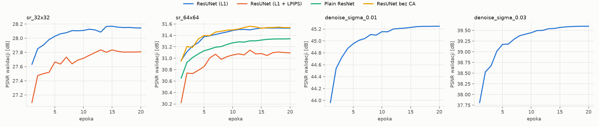

*Rys. 1. PSNR na zbiorze walidacyjnym po każdej epoce, dla wszystkich przebiegów.*

## 6. Metryki

| Metryka | Implementacja | Uwagi |
|---|---|---|
| MSE | średni błąd kwadratowy na obrazach [0, 1] | w temacie oznaczony jako „SNE” |
| PSNR | 10·log₁₀(1/MSE) | zgodny z `skimage.metrics.peak_signal_noise_ratio`, `data_range = 1`; wartość dla pojedynczego obrazu ograniczona do 100 dB |
| SSIM | `skimage.metrics.structural_similarity` | `data_range = 1`, `channel_axis = -1` |
| LPIPS | pakiet `lpips`, sieć AlexNet | wejście przeskalowane do [-1, 1]; do straty przy uczeniu użyto osobnej sieci VGG |

Każdą metrykę liczono osobno dla każdego obrazu testowego i uśredniano po całym zbiorze testowym (3 598 obrazów).

Ograniczenie PSNR do 100 dB było konieczne, bo kilka testowych fragmentów to idealnie jednolite niebo. Bicubic odtwarza je bezbłędnie, MSE wynosi 0, a PSNR jest nieskończony, co psułoby średnią. Ograniczenie dotyczy wyłącznie metody bazowej i lekko zawyża jej wynik, więc porównanie jest ostrożne.

## 7. Wyniki

Nazwy metod w tabelach mają postać `<metoda>_<zadanie>_<parametr>`. Przykładowo `bicubic_sr_32x32` to interpolacja bikubiczna z wejścia 32×32, a `bilateral_denoise_sigma_0.03` to filtr bilateralny przy szumie σ = 0.03. Wiersz `degraded_input` to metryki samego zaszumionego wejścia, czyli punkt odniesienia. Najlepszy wynik w kolumnie jest pogrubiony. Te same tabele w formacie LaTeX są w pliku `tabele.tex`.

### 7.1 Zwiększanie rozdzielczości

| Metoda | MSE | PSNR [dB] ↑ | SSIM ↑ | LPIPS ↓ |
|---|---:|---:|---:|---:|
| bicubic_sr_32x32 | 0.00597 | 26.39 | 0.6209 | 0.5646 |
| resunet_sr_32x32 | **0.00490** | **27.41** | **0.6727** | 0.4222 |
| resunet-lpips_sr_32x32 | 0.00506 | 27.06 | 0.6603 | **0.3084** |

*Tabela 1. Zwiększanie rozdzielczości z 32×32 do 256×256 (×8). Średnie na zbiorze testowym DIV2K, n = 3 598.*

| Metoda | MSE | PSNR [dB] ↑ | SSIM ↑ | LPIPS ↓ |
|---|---:|---:|---:|---:|
| bicubic_sr_64x64 | 0.00331 | 29.37 | 0.7673 | 0.3872 |
| resunet_sr_64x64 | 0.00243 | **30.89** | **0.8181** | 0.2574 |
| resunet-lpips_sr_64x64 | 0.00255 | 30.43 | 0.8082 | **0.1850** |
| plain_sr_64x64 | 0.00258 | 30.61 | 0.8107 | 0.2707 |
| resunet-noca_sr_64x64 | **0.00242** | 30.87 | 0.8177 | 0.2646 |

*Tabela 2. Zwiększanie rozdzielczości z 64×64 do 256×256 (×4). Średnie na zbiorze testowym DIV2K, n = 3 598. Wiersze `plain` i `resunet-noca` to eksperymenty ablacyjne opisane w rozdziale 8.*

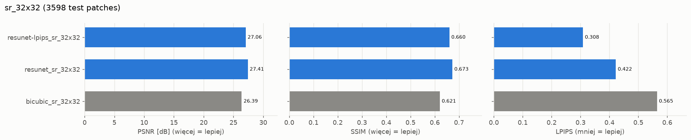

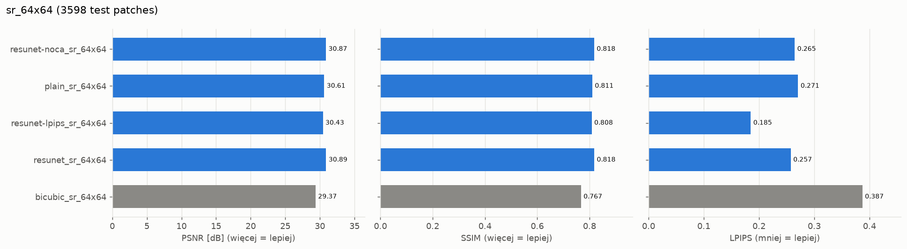

*Rys. 2. Średnie metryki dla zwiększania rozdzielczości. Szare słupki to metoda bazowa, niebieskie to sieci.*

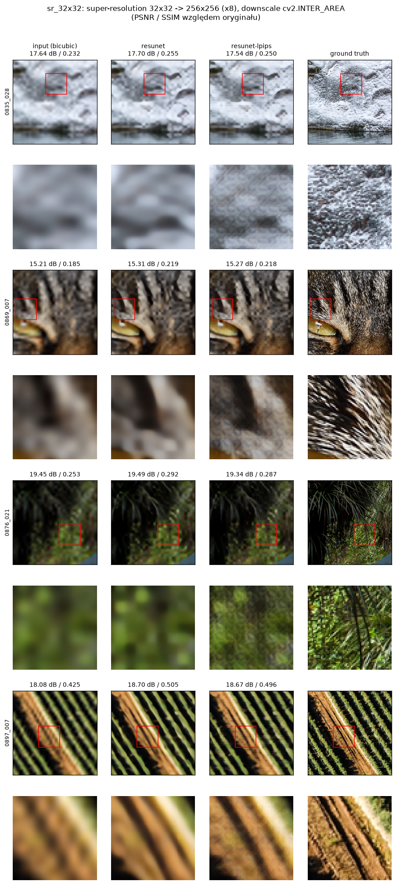

*Rys. 3. Zwiększanie rozdzielczości ×8 na czterech szczegółowych fragmentach z różnych zdjęć testowych. Pod każdym wierszem powiększony wycinek zaznaczony czerwoną ramką. Nad obrazami PSNR i SSIM względem oryginału.*

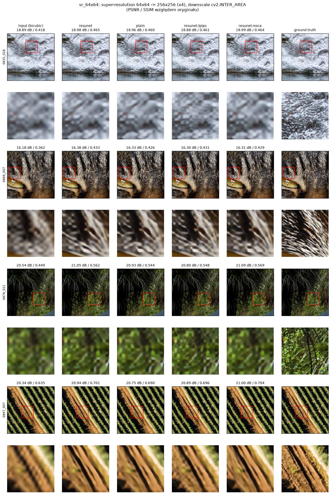

*Rys. 4. Zwiększanie rozdzielczości ×4, wszystkie warianty sieci, te same fragmenty co na rys. 3.*

### 7.2 Odszumianie

| Metoda | MSE | PSNR [dB] ↑ | SSIM ↑ | LPIPS ↓ |
|---|---:|---:|---:|---:|
| degraded_input_denoise_sigma_0.01 | 0.00010 | 40.09 | 0.9565 | 0.0191 |
| bilateral_denoise_sigma_0.01 | 0.00007 | 41.99 | 0.9793 | 0.0144 |
| resunet_denoise_sigma_0.01 | **0.00003** | **45.32** | **0.9897** | **0.0063** |

*Tabela 3. Odszumianie, szum gaussowski σ = 0.01. Średnie na zbiorze testowym DIV2K, n = 3 598.*

| Metoda | MSE | PSNR [dB] ↑ | SSIM ↑ | LPIPS ↓ |
|---|---:|---:|---:|---:|
| degraded_input_denoise_sigma_0.03 | 0.00087 | 30.63 | 0.7530 | 0.1409 |
| bilateral_denoise_sigma_0.03 | 0.00040 | 34.63 | 0.9124 | 0.0789 |
| resunet_denoise_sigma_0.03 | **0.00015** | **39.45** | **0.9662** | **0.0336** |

*Tabela 4. Odszumianie, szum gaussowski σ = 0.03. Średnie na zbiorze testowym DIV2K, n = 3 598.*

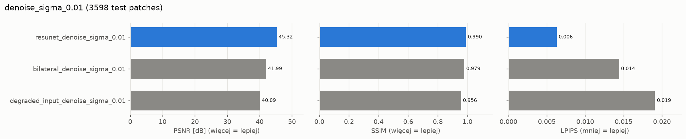

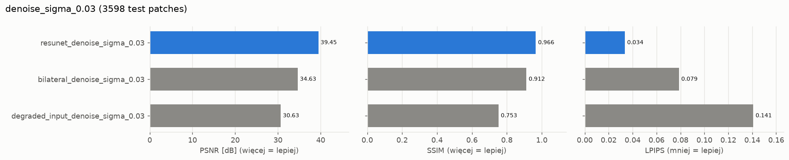

*Rys. 5. Średnie metryki dla odszumiania. Szare słupki to zaszumione wejście i metoda bazowa.*

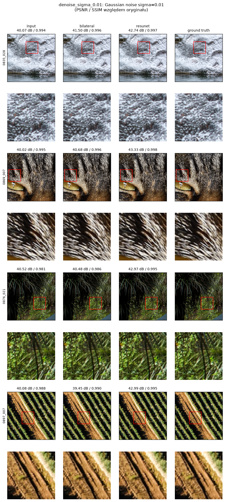

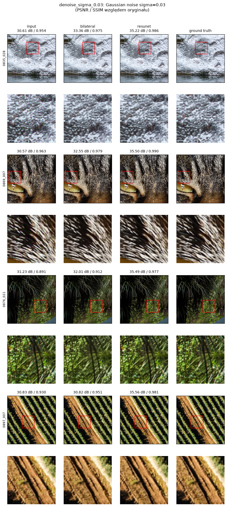

*Rys. 6. Odszumianie przy σ = 0.01 (góra) i σ = 0.03 (dół), z powiększonymi wycinkami.*

### 7.3 Wyniki dla pojedynczych obrazów

Średnie mogą ukrywać, że metoda jest lepsza tylko na części obrazów. Dlatego porównano też zysk PSNR sieci nad metodą bazową na każdym obrazie testowym osobno.

| Wariant | Sieć lepsza w PSNR | Sieć lepsza w LPIPS | Mediana zysku PSNR |
|---|---:|---:|---:|
| SR 32×32 | 96.2% obrazów | 96.4% obrazów | +0.75 dB |
| SR 64×64 | 98.4% obrazów | 99.2% obrazów | +1.14 dB |
| szum σ = 0.01 | 100% obrazów | 96.1% obrazów | +3.09 dB |
| szum σ = 0.03 | 100% obrazów | 91.6% obrazów | +4.56 dB |

*Tabela 5. Odsetek obrazów testowych, na których ResUNet jest lepszy od metody bazowej.*

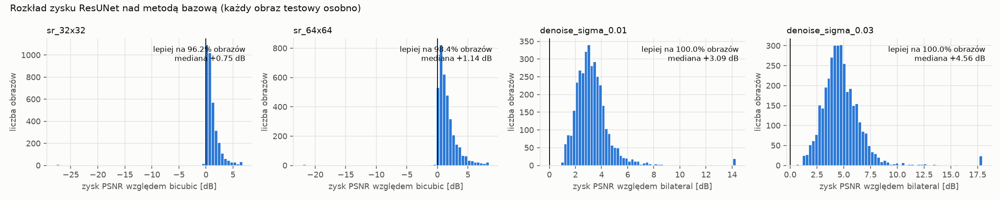

*Rys. 7. Rozkład zysku PSNR ResUNet nad metodą bazową. Pionowa linia oznacza brak zysku.*

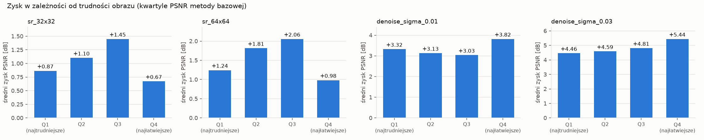

*Rys. 8. Średni zysk w zależności od trudności obrazu. Obrazy podzielono na kwartyle według PSNR metody bazowej: Q1 to obrazy najtrudniejsze dla metody bazowej, Q4 najłatwiejsze.*

## 8. Eksperymenty dodatkowe

Wszystkie przeprowadzono na zwiększaniu rozdzielczości, przy tych samych ustawieniach uczenia co model główny.

### 8.1 Wpływ funkcji straty (`resunet-lpips`)

Do straty L1 dodano składnik perceptualny: 0.1·LPIPS liczone siecią VGG. Do ewaluacji użyto innej sieci, AlexNet, żeby model nie optymalizował wprost metryki, którą jest oceniany.

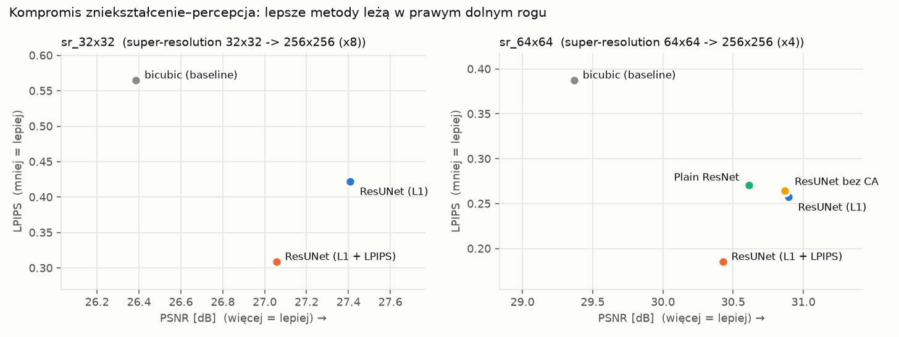

*Rys. 9. Każda metoda jako punkt (PSNR, LPIPS). Lepsze metody leżą w prawym dolnym rogu.*

### 8.2 Ablacja architektury (SR 64×64)

| Wariant | Opis | Parametry | PSNR [dB] | LPIPS |
|---|---|---:|---:|---:|
| resunet | pełna architektura | 10.18 mln | **30.89** | **0.2574** |
| resunet-noca | bez channel attention | 10.12 mln | 30.87 | 0.2646 |
| plain | jednoskalowa sieć w stylu EDSR: 16 bloków rezydualnych z CA, 64 kanały, bez U-Netu | 1.23 mln | 30.61 | 0.2707 |

*Tabela 6. Ablacja architektury, SR 64×64, zbiór testowy.*

## 9. Wnioski

1. **Proponowana sieć jest lepsza od metody bazowej w obu zadaniach i obu wariantach, we wszystkich metrykach.** Przewaga dotyczy niemal każdego obrazu testowego, a nie tylko średniej (tabela 5).

2. **Odszumianie zyskuje dużo więcej niż zwiększanie rozdzielczości.** Przy odszumianiu informacja o obrazie jest w większości obecna, a sieć uczy się oddzielać szum od tekstury. Filtr bilateralny tego nie potrafi: wygładza teksturę razem z szumem, co widać na sierści i trawie na rys. 6. Przy słabym szumie, nawet po dostrojeniu, poprawia wejście tylko o 1.9 dB, a sieć o 5.2 dB. Wraz z siłą szumu przewaga sieci rośnie, z +3.3 dB do +4.8 dB.

3. **W zwiększaniu rozdzielczości zysk jest stały, ale ograniczony przez brak informacji.** Wynosi +1.0 dB przy ×8 i +1.5 dB przy ×4. Obraz 32×32 zawiera 64 razy mniej pikseli niż wynik, więc drobna tekstura jest bezpowrotnie utracona. Sieć uczona stratą L1 przewiduje średnią z możliwych rozwiązań, dlatego wyostrza krawędzie, ale nie odtwarza tekstury (rys. 3).

4. **Największy zysk przy SR jest na obrazach średnio trudnych** (rys. 8). Są to obrazy z wyraźnymi krawędziami, które sieć potrafi wyostrzyć. Na obrazach z bardzo drobną teksturą brakuje informacji, a na obrazach gładkich bicubic jest już prawie bezbłędny. Przy odszumianiu zysk jest podobny we wszystkich kwartylach.

5. **PSNR i SSIM nie mierzą jakości percepcyjnej.** Dodanie LPIPS do straty obniża PSNR o ok. 0.4 dB, ale poprawia LPIPS o 27–28%. Obrazy są wyraźnie ostrzejsze, bo sieć „dorysowuje” wiarygodną teksturę. To znany kompromis między zniekształceniem a percepcją (perception–distortion tradeoff): nie da się jednocześnie minimalizować obu. Przy ×8 strata perceptualna wprowadza delikatny artefakt szachownicy (rys. 3), typowy dla połączenia straty perceptualnej z transponowaną konwolucją. Wybór straty zależy od zastosowania: do pomiarów lepsza jest L1, do oglądania przez człowieka L1 + LPIPS.

6. **Architektura.** Pełny ResUNet jest lepszy od prostej sieci jednoskalowej o 0.28 dB PSNR. Prosta sieć ma jednak 8 razy mniej parametrów, więc tego eksperymentu nie można traktować jako czystego dowodu przewagi struktury U-Net. Wpływ struktury i rozmiaru sieci się nakłada. Prosta sieć osiąga ok. 80% zysku ResUNet nad bicubic przy 8 razy mniejszym rozmiarze. Channel attention daje pomijalną poprawę: 0.02 dB PSNR i 0.007 LPIPS.

7. **Dłuższy trening niewiele by dał.** Krzywe walidacji są niemal płaskie od 15. epoki (rys. 1). Dalszą poprawę dałaby raczej większa sieć, strata adwersarialna przy SR albo trening jednego modelu na wielu poziomach szumu.

## 10. Odtworzenie wyników

```bash
uv sync
uv run python scripts/prepare_data.py --div2k-dir data/raw --out data/patches
uv run python scripts/tune_baselines.py
TASKS="sr:32 sr:64 denoise:0.01 denoise:0.03" bash scripts/run_all.sh   # uczenie, ewaluacja, raport
bash scripts/run_extra.sh                                                # eksperymenty dodatkowe
uv run python scripts/doc_figures.py                                     # wykresy analityczne
```

Pełny opis skryptów i parametrów jest w `README.md`.
