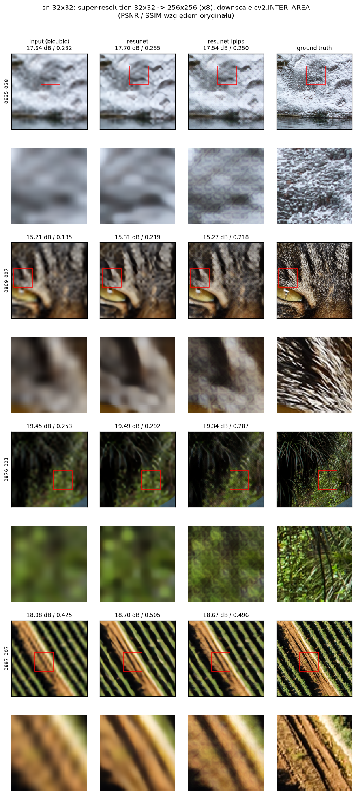
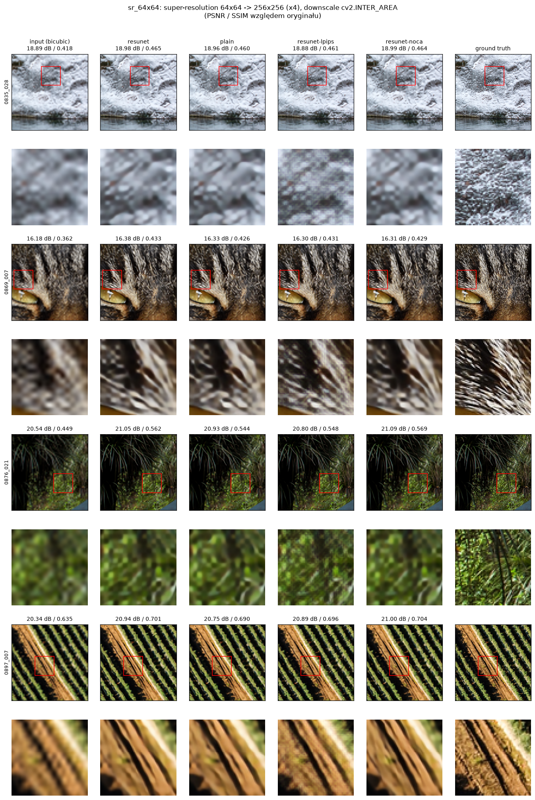
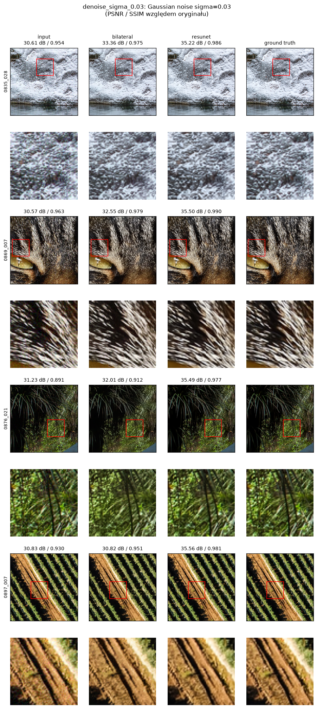
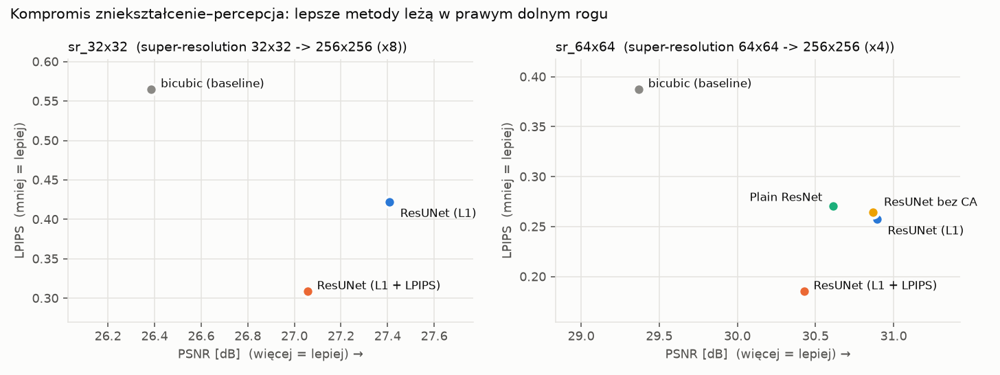

# Modyfikacja obrazów: zwiększanie rozdzielczości i odszumianie

Projekt SIGK. Zrealizowane zadania: **2.1 Zwiększanie rozdzielczości** i **2.2 Odszumianie**. Zbiór danych: DIV2K. Implementacja: Python i PyTorch.

## 1. Dane i przygotowanie wejść

Obrazy HR z DIV2K pocięto na fragmenty 256×256:

| Zbiór | Źródło | Liczba fragmentów |
|---|---|---:|
| treningowy | DIV2K_train_HR 0001–0760 | 12 160 |
| walidacyjny | DIV2K_train_HR 0761–0800 | 160 |
| testowy | DIV2K_valid_HR 0801–0900, pełna siatka | 3 598 |

- **Zwiększanie rozdzielczości:** zmniejszenie do 32×32 lub 64×64 przez `cv2.resize` z interpolacją **`cv2.INTER_AREA`**, czyli uśrednianiem obszaru, które nie powoduje aliasingu. Sieć dostaje obraz powiększony bikubicznie do 256×256.
- **Odszumianie:** `skimage.util.random_noise(mode="gaussian", var=σ²)` dla σ = 0.01 i 0.03, na obrazach w przedziale [0, 1].

Degradacje zbioru testowego są deterministyczne, więc metoda bazowa i sieć dostają identyczne wejścia.

## 2. Metody bazowe

- **Bicubic:** `cv2.resize(..., interpolation=cv2.INTER_CUBIC)`.
- **Filtr bilateralny:** `skimage.restoration.denoise_bilateral`. Parametry dobrano przeszukiwaniem siatki na zbiorze walidacyjnym. Dla σ = 0.01 wyszło `sigma_color` = 0.005 i `sigma_spatial` = 8, a dla σ = 0.03 odpowiednio 0.02 i 3.

## 3. Proponowana architektura: ResUNet

Ta sama sieć, ok. 10.2 mln parametrów, służy do obu zadań.

- **Struktura U-Net** z 3 poziomami (64, 128, 256, 256 kanałów) i połączeniami pomijającymi. Duże pole recepcyjne pozwala odtwarzać szersze struktury.
- **Bloki rezydualne z channel attention**, jak w sieci RCAN, po 2 na każdym etapie.
- **Globalne połączenie rezydualne:** sieć przewiduje tylko poprawkę do wejścia. Ostatnia warstwa jest zainicjalizowana zerami, więc nieuczona sieć zwraca wejście.

**Uczenie:** strata L1, AdamW (lr = 2·10⁻⁴), harmonogram kosinusowy, batch 16, 20 epok, augmentacja odbiciami i obrotami. Wybierany jest model z najlepszym PSNR na walidacji. Jedna konfiguracja trenuje się ok. 1.2 h na RTX 5060 Ti. Krzywe walidacji są płaskie od ok. 15. epoki, więc modele są zbieżne.

**Metryki:** MSE, PSNR, SSIM (skimage, `data_range` = 1) i LPIPS (AlexNet), liczone dla każdego obrazu i uśrednione po całym zbiorze testowym. PSNR pojedynczego obrazu ograniczono do 100 dB. Kilka jednolitych fragmentów nieba bicubic odtwarza bezbłędnie, co dawałoby nieskończoną średnią.

## 4. Wyniki na zbiorze testowym (n = 3 598)

| Metoda | PSNR [dB] ↑ | SSIM ↑ | LPIPS ↓ |
|---|---:|---:|---:|
| bicubic_sr_32x32 | 26.39 | 0.6209 | 0.5646 |
| resunet_sr_32x32 | **27.41** | **0.6727** | **0.4222** |

*Tabela 1. Zwiększanie rozdzielczości 32×32 → 256×256 (×8).*

| Metoda | PSNR [dB] ↑ | SSIM ↑ | LPIPS ↓ |
|---|---:|---:|---:|
| bicubic_sr_64x64 | 29.37 | 0.7673 | 0.3872 |
| resunet_sr_64x64 | **30.89** | **0.8181** | **0.2574** |

*Tabela 2. Zwiększanie rozdzielczości 64×64 → 256×256 (×4).*

| Metoda | PSNR [dB] ↑ | SSIM ↑ | LPIPS ↓ |
|---|---:|---:|---:|
| degraded_input_denoise_sigma_0.01 | 40.09 | 0.9565 | 0.0191 |
| bilateral_denoise_sigma_0.01 | 41.99 | 0.9793 | 0.0144 |
| resunet_denoise_sigma_0.01 | **45.32** | **0.9897** | **0.0063** |

*Tabela 3. Odszumianie, σ = 0.01.*

| Metoda | PSNR [dB] ↑ | SSIM ↑ | LPIPS ↓ |
|---|---:|---:|---:|
| degraded_input_denoise_sigma_0.03 | 30.63 | 0.7530 | 0.1409 |
| bilateral_denoise_sigma_0.03 | 34.63 | 0.9124 | 0.0789 |
| resunet_denoise_sigma_0.03 | **39.45** | **0.9662** | **0.0336** |

*Tabela 4. Odszumianie, σ = 0.03.*

Wiersz `degraded_input` to metryki samego zaszumionego wejścia. Tabele z MSE w formacie LaTeX są w pliku `tabele.tex`. Sieć jest lepsza od metody bazowej nie tylko średnio, ale też na pojedynczych obrazach: przy SR na 96–98% obrazów testowych, a przy odszumianiu na 100%.

*Rys. 1. Zwiększanie rozdzielczości ×8. Pod każdym wierszem powiększony wycinek z czerwonej ramki. Nad obrazami PSNR i SSIM.*

*Rys. 2. Zwiększanie rozdzielczości ×4, wszystkie warianty sieci.*

*Rys. 3. Odszumianie, σ = 0.03.*

## 5. Eksperymenty dodatkowe (zwiększanie rozdzielczości)

| Metoda | PSNR [dB] ↑ | SSIM ↑ | LPIPS ↓ | Parametry |
|---|---:|---:|---:|---:|
| resunet_sr_64x64 (L1) | **30.89** | **0.8181** | 0.2574 | 10.2 mln |
| resunet-lpips_sr_64x64 (L1 + 0.1·LPIPS) | 30.43 | 0.8082 | **0.1850** | 10.2 mln |
| resunet-noca_sr_64x64 (bez channel attention) | 30.87 | 0.8177 | 0.2646 | 10.1 mln |
| plain_sr_64x64 (sieć jednoskalowa w stylu EDSR) | 30.61 | 0.8107 | 0.2707 | 1.2 mln |
| resunet-lpips_sr_32x32 (L1 + 0.1·LPIPS) | 27.06 | 0.6603 | 0.3084 | 10.2 mln |

*Tabela 5. Wpływ funkcji straty i ablacja architektury.*

*Rys. 4. Każda metoda jako punkt (PSNR, LPIPS). Lepsze metody leżą w prawym dolnym rogu.*

## 6. Wnioski

1. **ResUNet jest lepszy od metody bazowej w obu zadaniach, obu wariantach i we wszystkich metrykach.** Zysk PSNR wynosi +1.0 dB (SR ×8), +1.5 dB (SR ×4), +3.3 dB (σ = 0.01) i +4.8 dB (σ = 0.03).
2. **Odszumianie zyskuje dużo więcej niż SR.** Przy szumie informacja o obrazie jest w większości zachowana i sieć uczy się oddzielać szum od tekstury. Filtr bilateralny wygładza teksturę razem z szumem (rys. 3), a przy słabym szumie poprawia wejście tylko o 1.9 dB.
3. **W SR zysk ogranicza brak informacji.** Obraz 32×32 ma 64 razy mniej pikseli niż wynik. Sieć uczona stratą L1 wyostrza krawędzie, ale drobnej tekstury nie odtwarza, tylko ją uśrednia (rys. 1).
4. **PSNR i SSIM nie mierzą jakości percepcyjnej.** Strata L1 + LPIPS obniża PSNR o ok. 0.4 dB, ale poprawia LPIPS o 27–28%, a obrazy są ostrzejsze. To kompromis między zniekształceniem a percepcją (rys. 4). Przy ×8 pojawia się lekki artefakt szachownicy.
5. **Architektura.** Channel attention daje pomijalny zysk. Pełny ResUNet jest lepszy od sieci jednoskalowej o 0.28 dB, ale ta ma 8 razy mniej parametrów. Wpływu struktury U-Net nie da się więc oddzielić od rozmiaru sieci.
