# SIGK – Projekt 2: Low light image enhancement

Celem projektu jest sieć neuronowa (PyTorch), która rekonstruuje zdjęcie wykonane
przy ekstremalnie małym oświetleniu. Wejście jest ciemniejsze o 3 EV i ma
fizyczny szum matrycy. Sieć porównujemy z metodą bazową, czyli wyrównaniem
histogramu, za pomocą metryk PSNR, SSIM i LPIPS.

## Spis treści

1. [Dane i fizyka degradacji](#1-dane-i-fizyka-degradacji)
2. [Jak powstaje ground truth – kluczowa obserwacja](#2-jak-powstaje-ground-truth--kluczowa-obserwacja)
3. [Metoda](#3-metoda)
4. [Eksperymenty](#4-eksperymenty)
5. [Wyniki](#5-wyniki)
6. [Przypadki specjalne: przepalenia i kolory](#6-przypadki-specjalne-przepalenia-i-kolory)
7. [Odporność na inne warunki](#7-odporność-na-inne-warunki)
8. [Wnioski](#8-wnioski)
9. [Odtworzenie wyników](#9-odtworzenie-wyników)

---

## 1. Dane i fizyka degradacji

**Zbiór.** Używamy zbioru RAISE: zdjęcia wnętrz (Indoor) z aparatu Nikon D7000,
pierwsze 100 zdjęć z dołączonego pliku CSV (`RAISE_258.csv`). Pliki RAW (NEF)
mają 4928×3264 px. Przetwarzamy je z `half_size=True`, co daje ok. 2474×1640 px.

| Zbiór | Zdjęcia (kolejność z CSV) | Zastosowanie |
|---|---|---|
| train | 1–72 | trening (losowe wycinki 256×256) |
| val | 73–80 | wybór najlepszego checkpointu (pełne obrazy) |
| test | **81–100** | ewaluacja (20 ostatnich, zgodnie z treścią zadania) |

**Generacja wejścia** (`lle/raw_pipeline.py`). Bazą jest skrypt z treści zadania,
w którym uzupełniliśmy trzy funkcje z TODO:

```python
def reduce_exposure(linear_img, ev_shift):
    return linear_img * np.float32(2.0 ** ev_shift)      # −3 EV → ×1/8

def apply_gamma_correction(img, gamma=2.2):
    return np.power(np.clip(img, 0.0, 1.0), 1.0 / gamma)

def convert_to_8bit(img):
    return np.clip(np.round(img * 255.0), 0, 255).astype(np.uint8)
```

Kolejność operacji wynika z fizyki powstawania obrazu na matrycy:

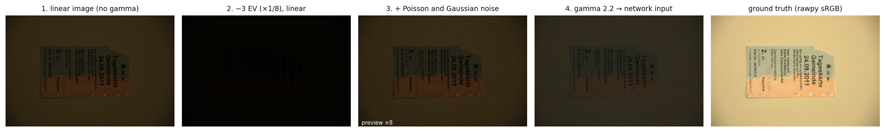

1. **Obraz liniowy.** `rawpy` wykonuje demozaikowanie i balans bieli, ale bez
   gammy i bez auto-jasności. Wartość piksela jest proporcjonalna do liczby
   zebranych fotonów.
2. **−3 EV.** Mnożymy obraz przez 2⁻³ = 1/8. To działa poprawnie *tylko* w
   przestrzeni liniowej, bo tylko tam „8 razy mniej światła” oznacza „8 razy
   mniejsza wartość”.
3. **Szum.** Szum fotonowy ma rozkład Poissona (`poisson(x/α)·α`, α = 0,001),
   a jego wariancja rośnie z sygnałem. Szum odczytu elektroniki jest gaussowski
   (σ = 0,005) i ma stałą wariancję. Oba dodajemy w przestrzeni liniowej, bo
   tylko tam zliczenia fotonów mają rozkład Poissona. Potem obcinamy wartości
   do [0, 1], co odpowiada nasyceniu piksela.
4. **Gamma 2,2 i kwantyzacja 8-bit.** Dopiero teraz obraz zostaje zakodowany do
   wyświetlenia. Po przyciemnieniu o 3 EV ciemne obszary mają tylko kilka–kilkanaście
   fotonów na piksel, więc stosunek sygnału do szumu jest bardzo niski.

Średnia jasność wejścia to ok. 0,11, a GT ok. 0,30. Histogram wejścia jest
ściśnięty w ciemnym zakresie:

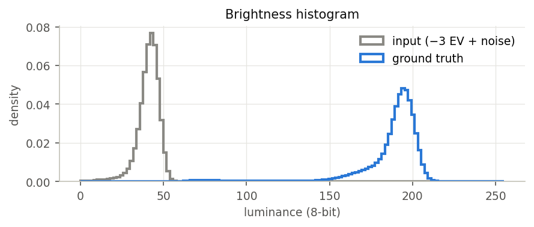

**Usprawnienia względem skryptu z instrukcji:**
- Zapisujemy także obraz liniowy (16-bit PNG). Dzięki temu w treningu szum
  można losować od nowa w każdej iteracji (`degrade_torch`, ta sama fizyka w
  PyTorch na GPU). Sprawdziliśmy, że statystyka zgadza się z wersją numpy
  (średnia 0,1113 i odchylenie szumu 0,0413 w obu wersjach).
- Szum ma stałe ziarno dla każdego pliku, więc zbiór testowy jest powtarzalny.
- Pobieranie odbywa się równolegle i z ponawianiem, bo serwer RAISE przy
  jednym połączeniu daje ok. 1 plik na minutę.

## 2. Jak powstaje ground truth – kluczowa obserwacja

GT powstaje przez `raw.postprocess(use_camera_wb=True, half_size=True)` z
domyślnymi parametrami. Domyślne parametry włączają dwa elementy ISP
(*image signal processor*), których wejście sieci nie zawiera:

1. **auto-bright (LibRaw):** obraz liniowy jest mnożony przez
   `k = 1 / max_c percentyl_99(lin_c)`, czyli tak, żeby ok. 1% pikseli było
   przepalonych,
2. **krzywa tonalna BT.709:** gamma 1/2,222 z liniowym odcinkiem o nachyleniu 4,5
   przy zerze. Wejście ma inną krzywą (czystą gammę 2,2).

Sprawdziliśmy to empirycznie: `bt709(min(k · lin, 1))` odtwarza GT z
**PSNR ≈ 55,6 dB**, czyli z dokładnością do kwantyzacji 8-bit. Na zbiorze
testowym wzmocnienie k waha się od **1,0 do 3,66**, bo każde zdjęcie jest
rozjaśniane inaczej.

Konsekwencja jest istotna. **Jasność GT zależy od percentyla całego zdjęcia.**
Sieć, która uczy się na wycinkach 256×256, nie widzi całego obrazu, więc nie
może wiedzieć, jak bardzo dany wycinek zostanie rozjaśniony. Ten sam wycinek
w dwóch różnych zdjęciach może mieć GT różniące się jasnością nawet 3,5 razy.

## 3. Metoda

### 3.1 Architektura: Residual U-Net z uwagą kanałową

Używamy U-Neta, czyli architektury z „Learning to See in the Dark” (Chen i in.,
CVPR 2018), zastosowanej tam do tego samego problemu. Wprowadziliśmy kilka
modyfikacji (`lle/models.py`):

| Element | Wybór |
|---|---|
| Poziomy | 4, kanały 32 → 64 → 128 → 256 → 256 (bottleneck) |
| Blok | rezydualny: conv3×3 → LeakyReLU → conv3×3, plus skrót |
| Uwaga | **channel attention** (RCAN): globalne uśrednienie cech, czyli informacja o całej scenie |
| Down / up | conv ze stride 2 / ConvTranspose 2×2 |
| Skip connections | konkatenacja + conv 1×1 |
| Wyjście | **poprawka** do obrazu bazowego (globalne połączenie rezydualne, ostatnia warstwa zainicjalizowana zerami) |
| Parametry | 5,97 M |

### 3.2 Trzy sposoby użycia sieci

| Tryb | Wejście sieci | Co przewiduje sieć | Część „fizyczna” (bez uczenia) |
|---|---|---|---|
| `e2e_srgb` | ciemne sRGB | poprawkę do wejścia → obraz jak GT | brak |
| `e2e_prior` | ciemne sRGB + wejście z wyrównaną ekspozycją (×8 w przestrzeni liniowej) | poprawkę do obrazu ×8 → obraz jak GT | odwrócenie −3 EV |
| **`isp`** | jak `e2e_prior` | **czysty obraz w oryginalnej ekspozycji** (bez szumu) | odwrócenie −3 EV **oraz ISP aparatu**: k z percentyla 99 *całego* wyjścia sieci + krzywa BT.709 |

Wariant `isp` dzieli problem tak, jak dzieli go fizyka:
- **sieć** robi to, czego nie da się opisać wzorem, czyli usuwa szum Poissona i
  Gaussa i odtwarza detale oraz kolory z kilku fotonów na piksel,
- **ISP** robi to, co jest deterministyczne i globalne, czyli auto-ekspozycję
  i krzywą tonalną. Auto-ekspozycja jest liczona na pełnym obrazie także
  wtedy, gdy sieć przetwarza obraz w kafelkach.

```
x (ciemne sRGB) ──► x_exp = (x^2.2·8)^(1/2.2) ──┐
       └──────────────────────────────────────── [x, x_exp] ──► U-Net ──► poprawka
                                                                              │
              y = x_exp + poprawka   (czysty obraz, gamma 2.2) ◄──────────────┘
              k = 1 / max_c percentyl_99(y^2.2)        ← z CAŁEGO obrazu
              wynik = BT.709(min(k · y^2.2, 1))
```

### 3.3 Trening

- **Strata (`isp`):** `L1(wynik, GT) + L1(y, lin^(1/2.2))`. Pierwszy człon
  liczymy w przestrzeni GT ze znanym k całego obrazu. Drugi to czysty obraz
  przed ISP i daje gradient także w obszarach przepalonych, gdzie krzywa po
  obcięciu ma pochodną 0. Warianty `e2e` używają samego `L1(wynik, GT)`.
- **Dane:** losowe wycinki 256×256, 32 na obraz na epokę, z obrotami o 90° i
  odbiciami. Szum jest generowany od nowa w każdej iteracji (tryb `online`).
- Adam (lr 2·10⁻⁴, cosine decay), batch 8, 60 epok, bf16 (AMP), gradient
  clipping 1,0.
- Walidacja co 3 epoki na **pełnych** obrazach, bo auto-ekspozycja jest globalna.
  Zapisujemy checkpoint z najlepszym PSNR.
- Czas: ok. 30 min na wariant na RTX 5050 Laptop (8 GB). Wariant z LPIPS
  zajmuje ok. 75 min. Inferencja pełnego obrazu 2474×1640 trwa ok. 0,25 s.

### 3.4 Metody bazowe (`lle/baselines.py`)

| Metoda | Opis |
|---|---|
| **`histeq`** – baseline z zadania | wyrównanie histogramu kanału Y (YCrCb), żeby nie zmieniać barwy |
| `histeq_rgb` | wyrównanie każdego kanału RGB osobno |
| `clahe` | CLAHE na kanale L (Lab) |
| `exposure` | odwrócenie −3 EV w przestrzeni liniowej, bez odszumiania |
| `exposure_nlm` | jak wyżej + odszumianie Non-Local Means |
| `isp_nlm` | ekspozycja ×8 + NLM + ISP rawpy, czyli „klasyczna” wersja wariantu `isp` |

## 4. Eksperymenty

| Wariant | Co sprawdza |
|---|---|
| `isp` | metoda główna |
| `e2e_srgb` | czy sieć sama nauczy się całej drogi od ciemnego wejścia do GT |
| `e2e_prior` | czy wystarczy podać sieci wejście z wyrównaną ekspozycją |
| `isp_fixed` | trening tylko na zapisanych parach PNG zamiast nowego szumu w każdej iteracji |
| `isp_lpips` | + strata perceptualna LPIPS (VGG) z wagą 0,1 |
| `isp_jitter` | losowy poziom szumu w treningu (α, σ × [0,5; 2]) |

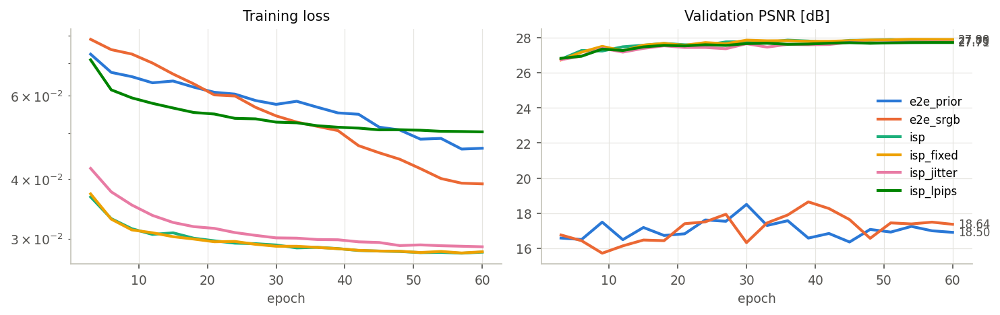

Warianty `isp*` po kilku epokach mają ok. 27 dB na walidacji i dochodzą do
27,7–27,9 dB. Warianty `e2e_*` zatrzymują się na 16–18,6 dB, a ich PSNR na
walidacji mocno skacze między epokami. Strata treningowa `e2e` spada, ale nie
przekłada się to na pełne obrazy. Sieć uczy się „średniej” jasności wycinków,
której nie da się przenieść na konkretne zdjęcie.

## 5. Wyniki

### 5.1 Tabela wymagana w zadaniu (20 obrazów testowych, średnia ± odchylenie)

| Metoda | PSNR [dB] ↑ | SSIM ↑ | LPIPS ↓ |
|---|---|---|---|
| baseline (wyrównanie histogramu) | 11,31 ± 3,37 | 0,152 ± 0,120 | 1,076 ± 0,239 |
| **network (`isp`)** | **29,74 ± 3,71** | **0,762 ± 0,151** | **0,261 ± 0,119** |

### 5.2 Wszystkie metody

| Metoda | PSNR ↑ | SSIM ↑ | LPIPS ↓ | ΔE (CIE76) ↓ | PSNR przepalenia ↑ | PSNR ciemne ↑ |
|---|---|---|---|---|---|---|
| wejście (bez zmian) | 11,79 | 0,257 | 0,739 | 33,7 | 4,75 | 23,97 |
| **histeq (baseline)** | 11,31 | 0,152 | 1,076 | 33,3 | 15,47 | 15,29 |
| histeq_rgb | 11,62 | 0,144 | 0,995 | 50,6 | 16,62 | 13,77 |
| CLAHE | 15,38 | 0,222 | 0,892 | 25,7 | 11,10 | 18,48 |
| ekspozycja ×8 | 16,82 | 0,233 | 0,798 | 27,1 | 18,63 | 17,41 |
| ekspozycja ×8 + NLM | 17,29 | 0,316 | 0,764 | 24,3 | 16,64 | 17,47 |
| ekspozycja ×8 + NLM + ISP | 19,95 | 0,320 | 0,742 | 19,8 | 24,57 | 17,74 |
| `e2e_srgb` | 22,72 | 0,642 | 0,411 | 10,5 | 17,33 | 29,30 |
| `e2e_prior` | 22,77 | 0,672 | 0,372 | 10,8 | 17,55 | 30,26 |
| **`isp`** | 29,74 | 0,762 | 0,261 | **5,83** | 26,15 | 32,38 |
| `isp_fixed` | **29,75** | **0,764** | 0,259 | **5,82** | **26,16** | **32,44** |
| `isp_jitter` | 29,48 | 0,756 | 0,266 | 5,93 | 25,82 | 32,15 |
| `isp_lpips` | 29,33 | 0,749 | **0,218** | 5,98 | 25,68 | 32,07 |

„Przepalenia” to piksele, w których GT ≥ 250 w którymś kanale. „Ciemne” to
piksele o luminancji GT < 0,1.

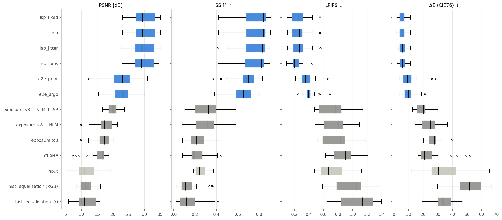

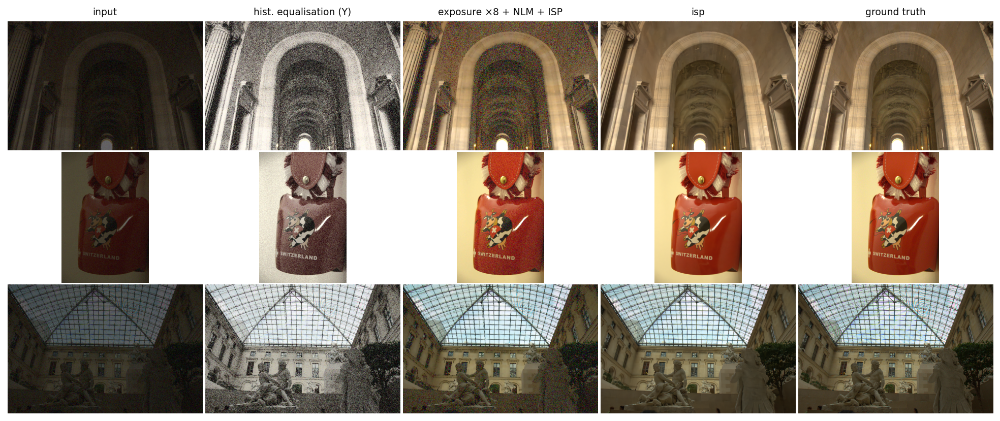

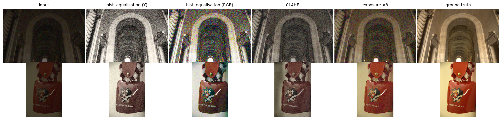

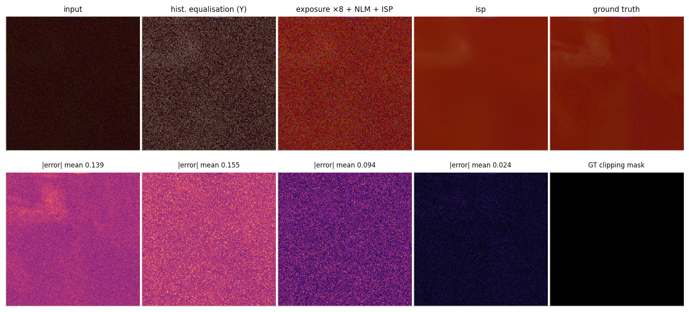

### 5.3 Obserwacje

1. **Wyrównanie histogramu jest gorsze niż samo wejście** (11,31 wobec 11,79 dB
   PSNR, SSIM 0,15). Rozciąga histogram do pełnego zakresu bez względu na
   prawdziwą jasność sceny, a przy okazji równie mocno wzmacnia szum. W ciemnych
   obszarach daje 15,3 dB, czyli o 8,7 dB mniej niż wejście. Wersja per kanał
   RGB dodatkowo psuje balans bieli (ΔE 50,6). Jako rozwiązanie low light
   enhancement przy silnym szumie wyrównanie histogramu się nie sprawdza.
2. **Sama fizyka bez uczenia daje ok. 20 dB.** Ekspozycja ×8 z NLM i ISP to
   najlepsza metoda klasyczna. Jej ograniczeniem jest odszumianie: NLM przy tak
   silnym szumie zależnym od sygnału zostawia plamy barwne albo rozmywa detale.
3. **Sieć `isp` dodaje ok. 10 dB do metody klasycznej i 18,4 dB do baseline'u.**
   LPIPS spada z 1,08 do 0,26, a błąd kolorów ΔE z 33 do 5,8.
4. **Wbudowanie ISP w model jest najważniejszą decyzją.** Ten sam U-Net
   trenowany end-to-end osiąga 22,7 dB, czyli o 7 dB mniej. Podanie wejścia z
   wyrównaną ekspozycją (`e2e_prior`) prawie nic nie zmienia, bo problemem nie
   jest 8-krotne rozjaśnienie, tylko globalne k zależne od całego zdjęcia.
   Warianty `e2e` dobrze odszumiają, co widać w PSNR ciemnych obszarów
   (30 dB), ale mylą się co do jasności całego obrazu.
5. **Szum losowany od nowa a stałe pary:** brak różnicy (29,74 wobec 29,75 dB).
   Przy losowych wycinkach, augmentacji i 60 epokach sieć nie zapamiętuje
   konkretnej realizacji szumu. Na zbiorze testowym o tym samym rozkładzie
   szumu nowy szum nie daje więc przewagi. Pomaga dopiero przy *losowym
   poziomie* szumu (`isp_jitter`, rozdział 7).
6. **LPIPS w stracie:** najlepszy LPIPS (0,218 zamiast 0,261) i węższy rozkład
   kosztem 0,4 dB PSNR. To klasyczny kompromis *perception–distortion*.

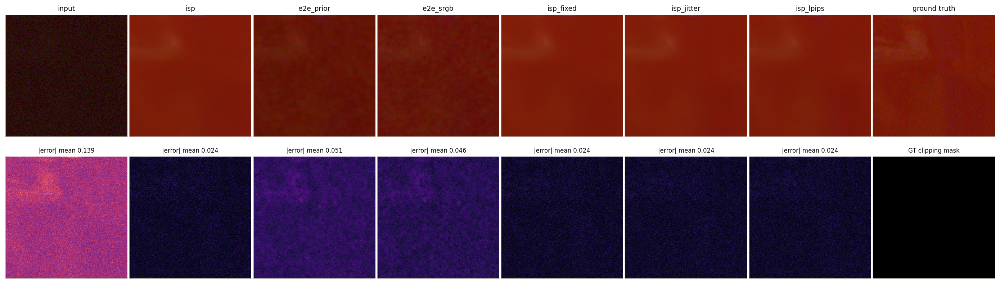

### 5.4 Dokładność auto-ekspozycji

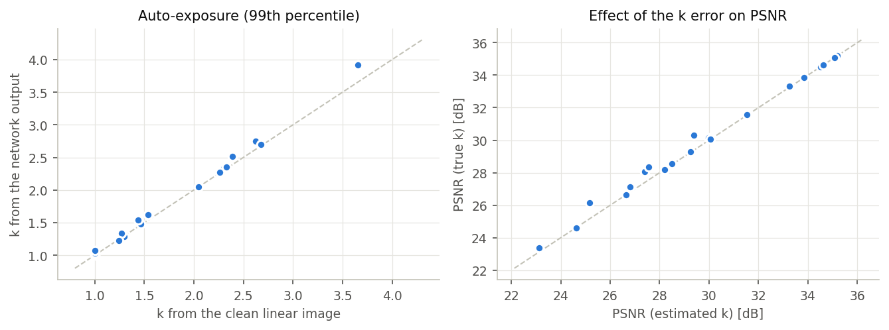

Wzmocnienie k liczone z wyjścia sieci różni się od k liczonego z czystego obrazu
średnio o **2,8%**. Z prawdziwym k PSNR wyniósłby 29,95 dB zamiast 29,74 dB,
więc estymacja kosztuje tylko 0,2 dB. Błąd jest prawie zawsze dodatni, czyli
k jest zawyżone. Oznacza to, że sieć lekko zaniża najjaśniejsze piksele: przy
silnym szumie przewidywanie dąży do średniej i wygładza światła.

## 6. Przypadki specjalne: przepalenia i kolory

### Przepalenia

Auto-bright w GT celowo przepala ok. 1% pikseli. Na zbiorze testowym jest to
1–12% pikseli obrazu, a w najjaśniejszym kanale więcej. W tych miejscach GT ma
wartość 255, ale nie da się z niego odczytać prawdziwej jasności sceny.

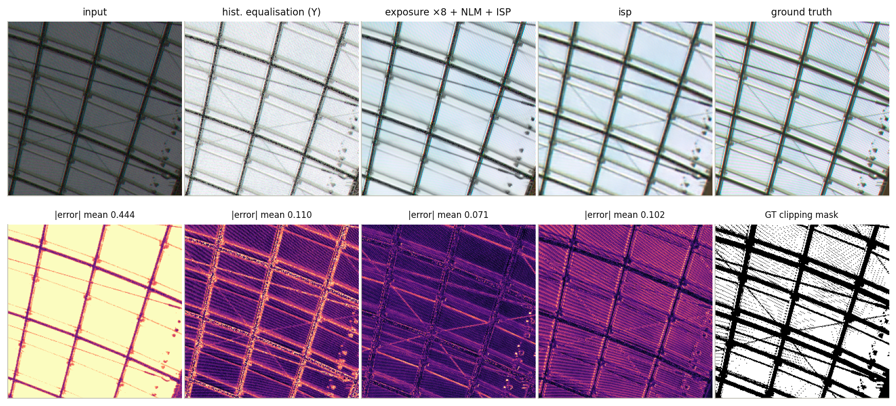

- Na wejściu przepalone obszary są szare (PSNR 4,75 dB), bo po przyciemnieniu
  o 8× nic nie jest nasycone.
- Wariant `isp` odtwarza przepalenia najlepiej (26,2 dB), bo przepala dokładnie
  tam, gdzie rawpy. Obcięcie `min(k·lin, 1)` jest częścią modelu. Warianty `e2e`
  muszą się nauczyć, *gdzie* GT jest przepalony, i osiągają tylko ok. 17,5 dB.
- **Najgorszy obraz testowy** (`redaf7d93t`, 23,1 dB) ma najwięcej przepaleń:
  12% pikseli (szklany dach na rysunku powyżej). To przypadek, w którym sieć
  przegrywa. W obszarze przepalonym tego zdjęcia ma 18,2 dB, mniej niż
  ekspozycja ×8 + NLM + ISP (21,7 dB) i nawet wyrównanie histogramu (20,1 dB).
  Mapa błędu pokazuje, że błąd skupia się na gęstej strukturze szyb i prętów.
  W GT jest tam drobny, wysokoczęstotliwościowy wzór (aliasing konstrukcji
  dachu), który z poziomu szumu wejścia jest nie do odróżnienia od szumu, więc
  sieć go wygładza. W efekcie część pikseli, które w GT dochodzą do nasycenia,
  na wyjściu sieci zostaje tuż poniżej progu. NLM wygładza słabiej i
  przypadkiem trafia w nasycenie częściej.
- W prawdziwie przepalonych miejscach *oryginalnego* RAW (k = 1, 6 obrazów
  testowych) informacji nie ma ani w wejściu, ani w GT. Sieć może tam tylko
  zwrócić biel.

### Kolory

- Szum Poissona jest niezależny w każdym kanale, więc w ciemnych obszarach
  powstają barwne plamy (chroma noise). Widać je w metodach klasycznych na
  rysunku porównawczym.
- **ΔE (CIE76):** `isp` ma 5,8 (różnica ledwo widoczna), metody `e2e` 10,5–10,8,
  wyrównanie histogramu 33, a wersja RGB 50,6. Wyrównanie kanałów RGB osobno
  niszczy balans bieli, a wyrównanie samej luminancji Y desaturuje obraz, bo
  przy tym samym Cr/Cb jaśniejszy piksel wydaje się mniej nasycony.
- Najtrudniejsze są ciemne, mocno nasycone kolory (czerwony dzwonek na rysunku
  porównawczym). Mają najmniej fotonów w dwóch z trzech kanałów, więc względny
  szum jest tam największy. Sieć dobrze zachowuje barwę, ale wygładza fakturę.

## 7. Odporność na inne warunki

Obrazy testowe zdegradowaliśmy na nowo dla innych EV i poziomów szumu. Sieci
były trenowane tylko dla −3 EV i nominalnego szumu.

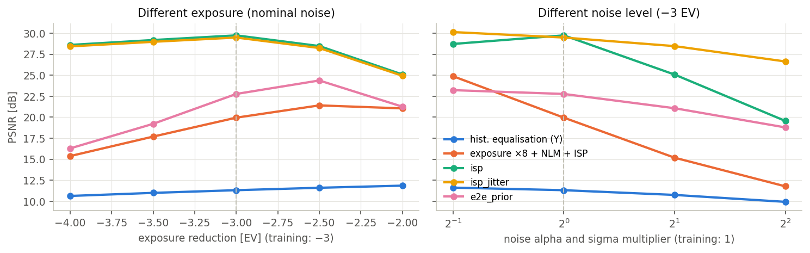

| Warunek | histeq | ISP + NLM | `e2e_prior` | `isp` | `isp_jitter` |
|---|---|---|---|---|---|
| −4 EV | 10,63 | 15,38 | 16,29 | **28,61** | 28,43 |
| −3 EV (trening) | 11,31 | 19,95 | 22,77 | **29,75** | 29,49 |
| −2 EV | 11,86 | 21,05 | 21,26 | **25,09** | 24,94 |
| szum ×0,5 | 11,62 | 24,88 | 23,22 | 28,72 | **30,14** |
| szum ×2 | 10,75 | 15,18 | 21,07 | 25,08 | **28,47** |
| szum ×4 | 9,93 | 11,77 | 18,79 | 19,56 | **26,64** |

- **Inna ekspozycja:** `isp` traci tylko 1,1 dB przy −4 EV, bo auto-ekspozycja
  ISP sama dopasowuje jasność. Przy −2 EV spada o 4,7 dB. Stały mnożnik ×8
  rozjaśnia wtedy obraz za mocno i obraz bazowy `x_exp` obcina się w jasnych
  miejscach, więc informacja ginie przed siecią. Wariant `e2e_prior` traci aż
  6,5 dB przy −4 EV, bo nauczył się jasności dla jednego konkretnego EV.
- **Inny poziom szumu:** `isp` jest wrażliwy na szum spoza rozkładu
  treningowego. Przy szumie ×4 spada do 19,6 dB, a co ciekawe gorzej mu idzie
  także przy *słabszym* szumie (×0,5), bo odszumia za mocno. **Losowanie
  poziomu szumu w treningu (`isp_jitter`)** rozwiązuje ten problem: przy szumie
  ×4 daje 26,6 dB (+7,1 dB) i najlepszy wynik przy ×0,5 i ×2. Na warunkach
  nominalnych traci tylko 0,26 dB. Do zastosowań praktycznych, gdzie ISO i
  ekspozycja się zmieniają, lepszym wyborem jest `isp_jitter`.

## 8. Wnioski

1. Sieć `isp` poprawia wynik baseline'u (wyrównania histogramu) z 11,3 do
   **29,7 dB PSNR**, z 0,15 do **0,76 SSIM** i z 1,08 do **0,26 LPIPS**.
   Wyrównanie histogramu przy silnym szumie jest gorsze niż brak przetwarzania.
2. Najważniejsze było **zrozumienie, jak powstaje GT**. Globalna auto-ekspozycja
   rawpy sprawia, że jasność zależy od całego zdjęcia, a nie od lokalnego
   wycinka. Wbudowanie ISP (auto-bright z percentyla 99 + BT.709) w model daje
   **+7 dB** względem tej samej sieci uczonej end-to-end.
3. Podział pracy, w którym sieć odszumia, a fizyka robi resztę, ma też inne
   zalety: model dobrze uogólnia się na inną ekspozycję i lepiej radzi sobie z
   przepaleniami, bo obcięcie jest częścią modelu.
4. Główne ograniczenia to szum spoza rozkładu treningowego (rozwiązuje to
   `isp_jitter`), wygładzanie faktur w najciemniejszych miejscach oraz obszary
   przepalone, gdzie informacja jest bezpowrotnie utracona.
5. Możliwe dalsze kroki: praca bezpośrednio na danych RAW (Bayer), tak jak w
   „Learning to See in the Dark”, gdzie szum jest jeszcze nieskorelowany
   przestrzennie przez demozaikowanie; warunkowanie sieci poziomem szumu, tak
   jak w FFDNet; większy zbiór zdjęć.

## 9. Odtworzenie wyników

```bash
just sync          # uv sync – środowisko (torch z CUDA 12.8)
just download      # 100 plików NEF (~1,9 GB)
just prepare       # pary wejście/GT + obrazy liniowe + split.json
just train-all     # 6 wariantów (~3,5 h na RTX 5050)
just evaluate      # results/summary_test.csv, results/table_test.md
just robustness    # results/robustness.csv
just figures       # docs/figures/*.png
```

| Plik | Zawartość |
|---|---|
| `results/table_test.md` | tabela wymagana w zadaniu |
| `results/summary_test.csv` | wszystkie metryki dla wszystkich metod |
| `results/per_image_test.csv` | metryki dla każdego obrazu testowego (w tym k estymowane/prawdziwe) |
| `results/robustness.csv` | test odporności |
| `results/preds/<metoda>/*.png` | wszystkie rekonstrukcje zbioru testowego |
| `runs/<wariant>/` | `best.pt`, `log.csv`, `config.json`, TensorBoard |
