# SIGK – Projekt 3: Rendering neuralny (model oświetlenia Phonga)

**Autorzy:** Kacper Multan, Mariusz Pakulski

Celem projektu jest sieć generatywna (PyTorch), która dla zadanych parametrów
sceny tworzy obraz kuli oświetlonej modelem Phonga. Obraz ma wyglądać tak, jak
wynik dostarczonego renderera OpenGL. Wybraliśmy **warunkowy GAN** (generator
U-Net, dyskryminator PatchGAN). Sieć jest połączona z rendererem: osobne okno
`NeuralPhongWindow` losuje scenę, renderuje referencję shaderem i równolegle
uruchamia sieć. Wyniki porównujemy z referencją metrykami **FLIP, LPIPS, SSIM**
oraz **odległością Hausdorffa** na krawędziach z detektora Canny’ego. Na
koniec odpowiadamy na pytanie, czy te metryki dobrze oddają jakość obrazów.

## Wynik główny

Zbiór testowy: 600 obrazów (20% z 3000), cały kadr 128×128, średnie po obrazach.

| Metoda | FLIP ↓ | LPIPS ↓ | SSIM ↑ | Hausdorff [px] ↓ |
|---|---|---|---|---|
| **neural renderer** (cGAN, kodowanie geometryczne) | **0,0014** | **0,0022** | **0,9989** | **2,05** |

Po ok. 28 min treningu sieć odtwarza położenie, kolor, cieniowanie i rozbłysk.
Mediana odległości Hausdorffa wynosi **1 px**. Pełne porównanie wariantów jest
w [rozdziale 5](#5-wyniki), a to, kiedy dyskryminator faktycznie pomaga, opisuje
[rozdział 5.1](#51-kiedy-gan-pomaga-gan-v2-vs-regresja-l1).

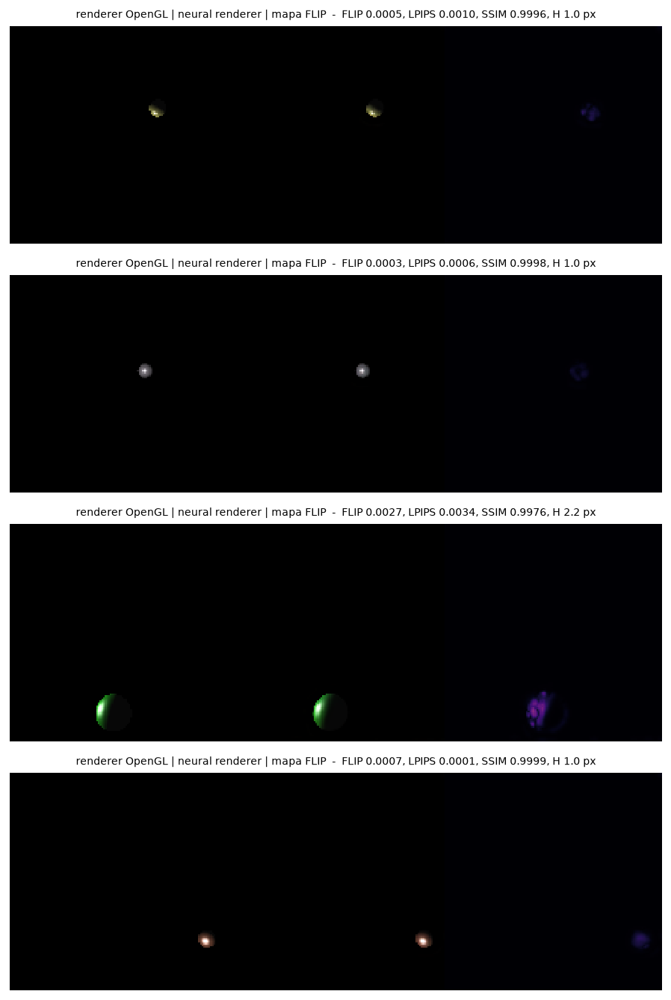

## Spis treści

1. [Scena i model Phonga](#1-scena-i-model-phonga)
2. [Generacja zbioru danych](#2-generacja-zbioru-danych)
3. [Metoda](#3-metoda)
4. [Eksperymenty](#4-eksperymenty)
5. [Wyniki](#5-wyniki)
6. [Czy metryki dobrze oddają jakość?](#6-czy-metryki-dobrze-oddają-jakość)
7. [Wnioski](#7-wnioski)
8. [Odtworzenie wyników](#8-odtworzenie-wyników)

---

## 1. Scena i model Phonga

Renderer (`SIGK___Projekt_3/src`, moderngl) rysuje siatkę kuli o promieniu 1
(`sphere.obj`, 4096 czworokątów, wygładzane normalne). Fragment shader
`phong.frag` liczy

```
I = ka·Ia  +  kd·max(L·N, 0)·Id  +  ks·max(R·V, 0)^n·Is
```

| Parametr | Wartość |
|---|---|
| ka (materiał, otoczenie) | [76, 76, 76] (stała) |
| kd (materiał, rozproszenie) | losowe, każda składowa z ⟨0, 255⟩ |
| ks (materiał, odbicie) | [255, 255, 255] (stała) |
| n (połyskliwość) | losowe z [3, 20] |
| położenie kuli | losowe, każda składowa z ⟨−20, 20⟩ |
| położenie światła punktowego | losowe, każda składowa z ⟨−20, 20⟩ |
| Ia, Id, Is (światło) | [25, 25, 25], [255, 255, 255], [255, 255, 255] |
| kamera | stała: (5, 5, 15) → (0, 0, 0), FOV 45°, obraz 128×128 |

Shader miał wpisane przybliżenia 0,3 i 0,1. Zmieniliśmy je na dokładne
76/255 i 25/255 z treści zadania. Kula nie jest skalowana ani obracana.

**Sprawdzenie konwencji kamery.** W `nr/scene.py` napisaliśmy analityczny
ray-tracer idealnej kuli (numpy) z tą samą kamerą. Jego obrazy pokrywają się z
rendererem OpenGL: maski kuli różnią się o 0–1 piksel, a maksymalna różnica
koloru wynosi ok. 1/255. Ray-tracer służy tylko do testów i do badania metryk,
a zbiór danych powstaje wyłącznie w dostarczonym rendererze.

## 2. Generacja zbioru danych

Losowanie dodaliśmy w `PhongWindow.on_render`, zgodnie ze wskazówką z treści
zadania. Każda klatka to nowa scena. Obraz trafia do `image_XXXX.png`, a
parametry do `params.jsonl`. Renderer działa w trybie `--window headless`
(kontekst EGL bez okna) i 3000 obrazów 128×128 generuje w ok. 6 s.

### 2.1 Sytuacje zdegenerowane (wskazówka 2)

Same przedziały ⟨−20, 20⟩ dopuszczają sceny, z których sieć niczego się nie
nauczy:

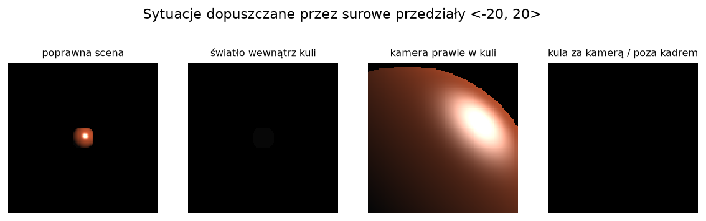

* **kula poza kadrem lub za kamerą.** Kamera widzi tylko mały stożek sześcianu
  ⟨−20, 20⟩³, więc przy losowaniu bez ograniczeń **ok. 80% scen to pusty, czarny
  obraz**,
* **kamera wewnątrz kuli lub tuż przy niej.** Kamera stoi w (5, 5, 15), czyli
  wewnątrz przedziału, więc kula może ją „połknąć” albo zostać przecięta płaszczyzną
  bliską,
* **światło wewnątrz kuli.** Wtedy L·N < 0 dla całej widocznej powierzchni i
  kula ma tylko kolor otoczenia. Model Phonga nie liczy cieni, więc taka scena
  jest i tak niefizyczna.

Dlatego stosujemy **losowanie z odrzucaniem** (`nr/scene.py: is_valid`).
Odrzucamy scenę, gdy:

* odległość kamera–kula < R + 1,
* odległość światło–kula < 1,25 R,
* kula leży za kamerą,
* rzut środka kuli wypada poza obraz (|NDC| > 1).

Dzięki ostatniemu warunkowi kula leży **w losowym miejscu kadru** (wskazówka 3),
a nie na jego środku. Może też być częściowo ucięta przez krawędź.

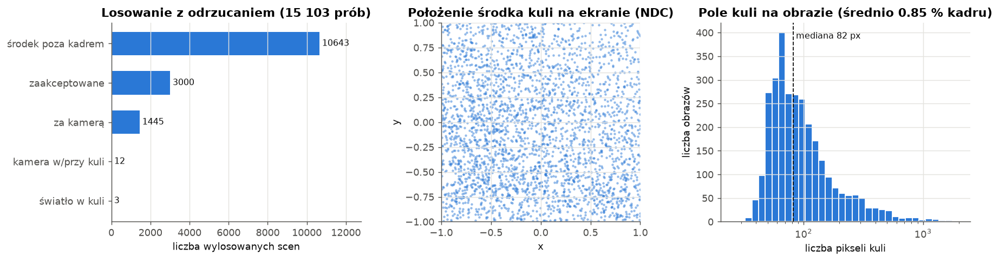

Z 15 103 losowań zaakceptowano 3000:

| Powód odrzucenia | Liczba scen |
|---|---|
| środek kuli poza kadrem | 10 643 |
| kula za kamerą | 1 445 |
| kamera w kuli lub przy niej | 12 |
| światło w kuli | 3 |

Środki kul są rozłożone równomiernie po ekranie (środkowy wykres).

**Ważna cecha zbioru: kule są małe.** Przy stałej kamerze i odległościach rzędu
15–35 jednostek kula ma średnio 0,85% powierzchni kadru, a mediana to
**82 piksele** (promień ok. 5 px). To wpływa na trening (rozdz. 3.3) i na
metryki (rozdz. 6).

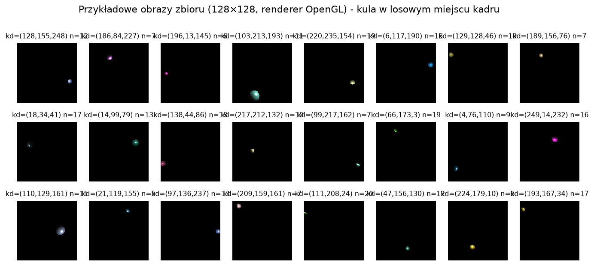

**Podział zbioru** (`data/dataset/split.json`, losowy, stałe ziarno):

| Zbiór | Liczba obrazów | Zastosowanie |
|---|---|---|
| test | **600** (20%) | wszystkie liczby w tabelach |
| walidacja | 200 | wybór checkpointu |
| trening | 2200 | uczenie sieci |

## 3. Metoda

### 3.1 Kodowanie parametrów (wskazówka 1)

Sieć dostaje 10 liczb: położenie kuli (3), położenie światła (3), kolor
rozproszenia (3) i połyskliwość (1). Wynikiem ma być obraz. Porównujemy trzy
sposoby podania tych parametrów sieci (`nr/encoding.py`). W każdym z nich
parametry są rozpropagowane na mapy 128×128, do których dodajemy współrzędne
piksela (CoordConv):

| Kodowanie | Kanały | Co dostaje sieć |
|---|---|---|
| `raw` | 12 | surowe parametry w układzie świata (podzielone przez 20, kolor przez 255) |
| `camera` (względne) | 19 | środek kuli **w układzie kamery**, jego rzut na ekran (NDC), rozmiar kątowy kuli, **kierunek i odległość światła względem kuli** (w układzie kamery), kolor, połyskliwość |
| `geometric` | 25 | `camera` + dwie mapy pikselowe: kierunek promienia kamery **d** oraz przesunięcie **q** promienia względem kierunku do środka kuli, unormowane przez promień kątowy |

Dla mapy **q** zachodzi |q| < 1 dokładnie wtedy, gdy promień trafia w kulę.
Mapa podaje więc położenie i rozmiar sylwetki, ale nie zawiera cieniowania.
Normalne, wartość N·L, wektor odbicia R, rozbłysk (R·V)ⁿ i kolor sieć musi
policzyć sama.

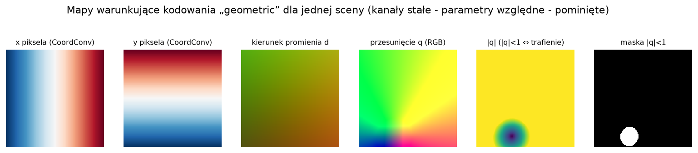

**Uzasadnienie.** W układzie świata jasność piksela zależy od parametrów w
mocno nieliniowy sposób. Sieć musiałaby nauczyć się rzutu perspektywicznego,
który jest stały, bo kamera się nie rusza. Zapis względny (kamera i kula) zdejmuje
tę część zadania z sieci. Mapa q idzie dalej i od razu przenosi informację „gdzie
na obrazie jest kula” w tę samą przestrzeń co obraz. Sieć konwolucyjna nie musi
wtedy niczego przenosić z pojedynczego wektora na właściwe piksele.

### 3.2 Architektura: warunkowy GAN (pix2pix)

* **Generator** (`nr/models.py: Generator`, 6,8 M parametrów):
  * U-Net na mapach warunkujących, 4 poziomy (128 → 8 px) z blokami
    rezydualnymi (GroupNorm + SiLU);
  * na wejściu konwolucja 1×1, na wyjściu blok rezydualny i sigmoida;
  * gałąź pełnej rozdzielczości liczy cieniowanie dla każdego piksela, a
    poziomy zgrubne dają duże pole recepcyjne, potrzebne, gdy sieć sama musi
    znaleźć kulę (`raw`).
* **Dyskryminator** (`PatchDiscriminator`, 2,8 M parametrów):
  * PatchGAN 70×70 ze spectral norm;
  * jest warunkowy, czyli dostaje te same mapy co generator i obraz:
    prawdziwy albo wygenerowany.
* **Straty:** LSGAN dla dyskryminatora oraz
  `L_G = 100 · L_rec + 1 · L_adv` dla generatora. Generator jest
  deterministyczny (bez szumu z), bo dla danych parametrów istnieje dokładnie
  jeden poprawny obraz.
* **Trening:**
  * Adam (lr 2·10⁻⁴, β = (0,5, 0,999)), batch 32, 150 epok (ok. 10 tys. kroków);
  * stały lr przez pierwszą połowę, potem liniowy spadek do 0;
  * EMA wag generatora (0,999);
  * bf16 (autocast);
  * cały zbiór siedzi w pamięci GPU (150 MB).
* **Wybór checkpointu:** najmniejszy błąd L1 na obszarze kuli w zbiorze
  walidacyjnym (warianty v2 i `*_l1` z rozdz. 5.1: najmniejszy LPIPS).

### 3.3 Strata rekonstrukcji: pułapka „czarnego obrazu”

Pierwsza wersja używała `L_rec = L1(cały obraz) + L1(obszar kuli)`, gdzie
obszar kuli to maska poszerzona o 2 px. Po 50 epokach **generator zwracał
całkowicie czarne obrazy**, nawet z kodowaniem `geometric`, które podaje
sylwetkę wprost. Działo się tak również bez GAN-a i w fp32.

Przyczyna: L1 prowadzi do **mediany**. Kula ma ok. 80 px, a pierścień maski i
ciemna strona kuli (sam kolor otoczenia, ok. 7/255) to ponad połowa pikseli
maski. Mediana tych pikseli jest więc prawie czarna i „wszystko czarne” staje
się silnym minimum lokalnym. Prosty MLP działający piksel po pikselu wychodził
z niego dopiero po ok. 1000 krokach, a U-Net nie wyszedł wcale.

Rozwiązanie (`scripts/train.py: rec_loss`):

```
L_rec = L1(cały obraz) + [ L1(kula) + 5 · MSE(kula) ]     (maska kuli poszerzona o 1 px)
```

* **MSE dąży do średniej, a nie do mediany**, więc wyprowadza sieć z minimum;
* drugi składnik jest uśredniany tylko po pikselach kuli, więc kula (<1% kadru)
  waży tyle samo co całe tło;
* dodatkowo ograniczyliśmy |q| ≤ 2: daleko od kuli wartości dochodziły do ~30
  i dominowały wejście.

Po tej zmianie L1 na kuli w walidacji spada stabilnie: 0,13 → 0,019.

### 3.4 GAN v2: dyskryminator, który widzi kulę

W pierwszej wersji (v1) straty dyskryminatora i generatora szybko stawały na
0,25, czyli na poziomie zgadywania w LSGAN. Powód: PatchGAN zwraca mapę 14×14
ocen, a strata to jej średnia. Ponad 95% komórek widzi tylko czarne tło,
**identyczne** w obrazie prawdziwym i wygenerowanym. Sygnał z kilku komórek z
kulą ginie w średniej. Wersja v2 (`scripts/train.py --adv-mask --fm-weight 10
--select lpips`) wprowadza trzy zmiany:

* **maskowana strata adwersarialna:** średnia tylko po komórkach mapy D, które
  widzą kulę w referencji albo jasne piksele (> 0,02) w predykcji, z maską
  poszerzoną o 4 px. Dzięki temu D ocenia też „mgłę” rysowaną przez generator
  na tle;
* **feature matching** (pix2pixHD): L1 między cechami pośrednimi D dla obrazu
  prawdziwego i wygenerowanego, z wagą 10. Stabilizuje trening i daje
  generatorowi gęstszy sygnał niż sama ocena D;
* **wybór checkpointu po LPIPS** zamiast po L1. L1 z definicji premiuje
  rozmycie, więc dla GAN-a był stronniczy.

## 4. Eksperymenty

| Wariant | Kodowanie | GAN | Czas treningu (RTX 5060 Ti, współdzielone GPU) |
|---|---|---|---|
| `geometric_gan` (główny) | geometric | tak | 28 min |
| `camera_gan` | camera | tak | 33 min |
| `raw_gan` | raw | tak | 31 min |
| `geometric_l1` | geometric | **nie** (tylko L_rec) | 21 min |
| `geometric_gan_v2` | geometric | tak, v2 (rozdz. 3.4) | 64 min* |
| `camera_gan_v2` | camera | tak, v2 | 55 min* |
| `camera_l1` | camera | **nie** | 34 min* |
| `raw_gan_v2` | raw | tak, v2 | 57 min* |
| `raw_l1` | raw | **nie** | 36 min* |

\* dwa treningi równolegle na jednym GPU.

Punkty odniesienia (bez uczenia):

* **czarny obraz:** „renderer”, który niczego nie rysuje; pokazuje, ile metryki
  dają za pustą scenę;
* **analityczny ray-tracing idealnej kuli:** praktycznie dolna granica błędu;
  różni się od referencji tylko fasetowaniem siatki i rasteryzacją.

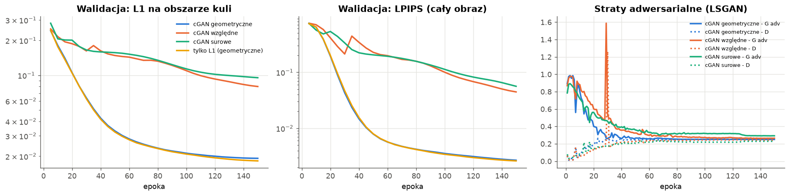

## 5. Wyniki

Metryki (`nr/metrics.py`):

* **FLIP:** oficjalny pakiet NVlabs `flip-evaluator`, tryb LDR, 67 ppd;
* **LPIPS:** AlexNet, v0.1;
* **SSIM:** `skimage`, 3 kanały, zakres danych 1;
* **Hausdorff:** symetryczna odległość Hausdorffa między pikselami krawędzi
  `cv2.Canny(gray, 50, 150)`. Gdy krawędzi nie ma w jednym z obrazów, metryka
  jest nieokreślona i przyjmujemy przekątną obrazu, **181 px**.

Wyjście sieci jest kwantyzowane do 8 bitów, tak jak obraz z renderera.

**Zbiór testowy (600 obrazów), cały kadr 128×128:**

| Metoda | FLIP ↓ | LPIPS ↓ | SSIM ↑ | Hausdorff [px] ↓ |
|---|---|---|---|---|
| **neural renderer** (cGAN, geometric) | **0,0014** | 0,0022 | 0,9989 | 2,05 |
| cGAN, camera | 0,0055 | 0,0434 | 0,9859 | 7,91 |
| cGAN, raw | 0,0058 | 0,0552 | 0,9851 | 13,52 |
| bez GAN (tylko L_rec), geometric | **0,0014** | **0,0021** | **0,9990** | **1,78** |
| cGAN v2, geometric | 0,0015 | 0,0023 | **0,9990** | 2,02 |
| cGAN v2, camera | 0,0050 | 0,0348 | 0,9876 | 6,23 |
| bez GAN, camera | 0,0081 | 0,0400 | 0,9732 | 6,19 |
| cGAN v2, raw | 0,0076 | 0,0588 | 0,9762 | 15,96 |
| bez GAN, raw | 0,0079 | 0,0610 | 0,9745 | 15,90 |
| *czarny obraz* | 0,0072 | 0,1795 | 0,9848 | 181,02 |
| *ray-tracing idealnej kuli* | 0,0001 | 0,0000 | 1,0000 | 0,28 |

Kula zajmuje <1% kadru, więc liczymy też metryki na **wycinku 64×64 wokół
środka kuli**. Ta tabela lepiej opisuje jakość samego obiektu:

| Metoda | FLIP ↓ | LPIPS ↓ | SSIM ↑ | Hausdorff [px] ↓ |
|---|---|---|---|---|
| **neural renderer** (cGAN, geometric) | 0,0056 | 0,0046 | 0,9955 | 1,79 |
| cGAN, camera | 0,0186 | 0,0927 | 0,9528 | 5,50 |
| cGAN, raw | 0,0215 | 0,1205 | 0,9461 | 8,39 |
| bez GAN, geometric | 0,0056 | 0,0041 | 0,9955 | 1,78 |
| cGAN v2, geometric | 0,0057 | 0,0045 | 0,9959 | 1,76 |
| cGAN v2, camera | 0,0163 | 0,0738 | 0,9602 | 4,72 |
| bez GAN, camera | 0,0206 | 0,0849 | 0,9358 | 4,68 |
| cGAN v2, raw | 0,0236 | 0,1270 | 0,9390 | 9,48 |
| bez GAN, raw | 0,0249 | 0,1331 | 0,9303 | 9,52 |
| *czarny obraz* | 0,0287 | 0,3381 | 0,9329 | 90,51 |
| *ray-tracing idealnej kuli* | 0,0003 | 0,0000 | 0,9999 | 0,28 |

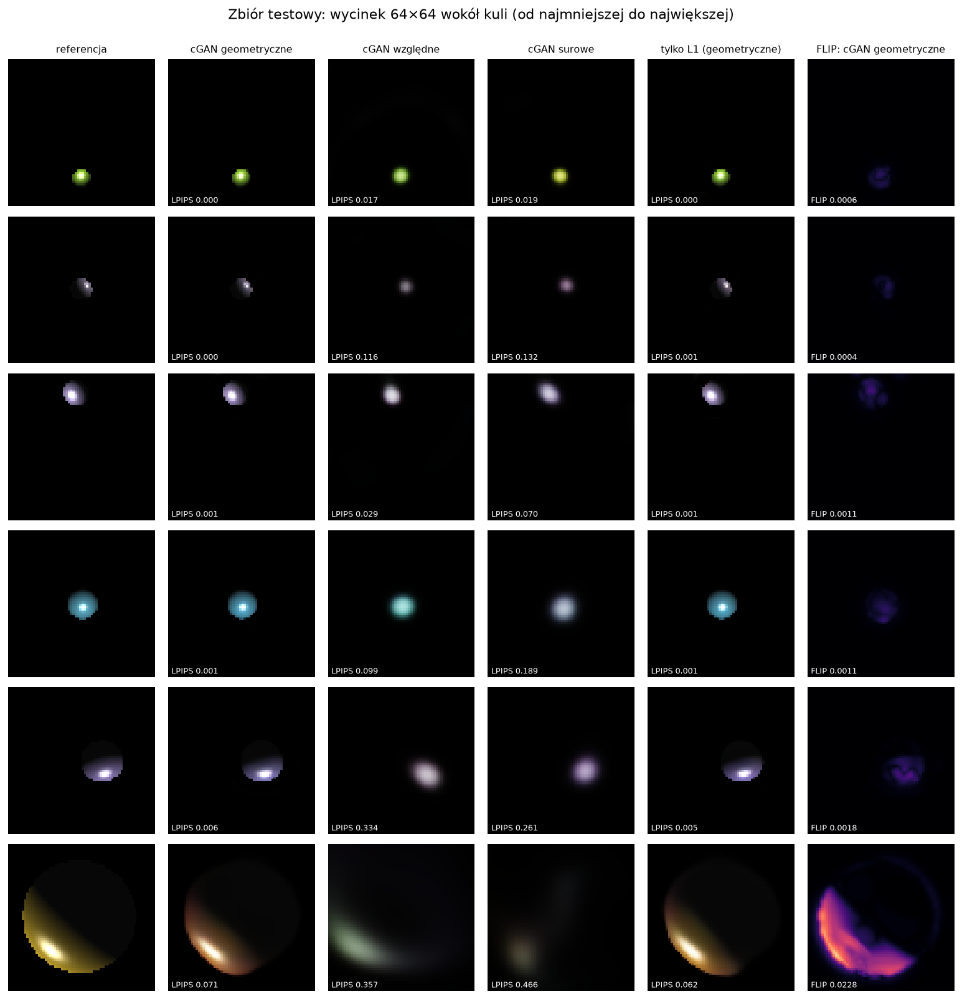

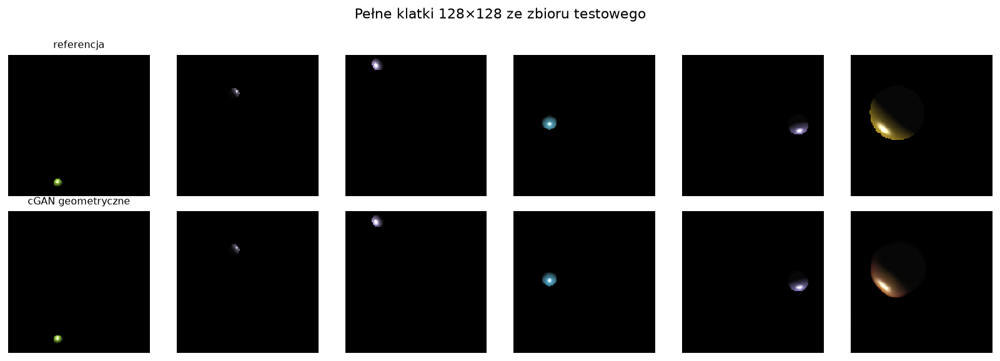

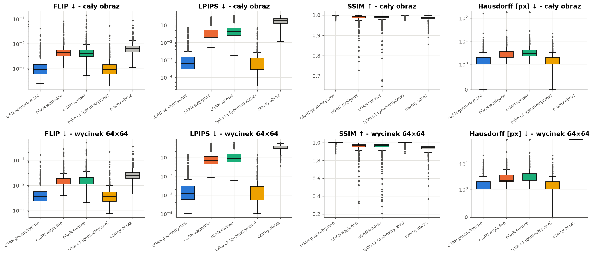

### Obserwacje

1. **Kodowanie parametrów jest najważniejszą decyzją.** Ta sama sieć z mapą
   `geometric` ma LPIPS (wycinek) 0,0046, a z parametrami względnymi 0,093, czyli
   20× więcej. Warianty `raw` i `camera` trafiają w położenie i kolor, ale kula
   jest rozmyta, a rozbłysk rozlany („regresja do średniej”). Duże kule
   (ostatni wiersz) wychodzą wręcz jako plamy. Zapis względny (`camera`) jest
   lepszy od surowego we wszystkich metrykach. Najwięcej widać w
   Hausdorffie: 7,9 vs 13,5 px. W tym przypadku przy `raw` ostre krawędzie
   częściej znikają całkiem (34 vs 16 obrazów bez krawędzi).
2. **`camera` i `raw` nie są zbieżne po 150 epokach.** Krzywe walidacyjne wciąż
   spadają, więc dłuższy trening poprawiłby te warianty. Przy tym samym budżecie
   kodowanie geometryczne osiąga końcowy błąd wariantu `camera` już po ok. 25 epokach (≈6× szybciej).
3. **Przewaga GAN-a zależy od kodowania** (szczegóły w rozdz. 5.1). Przy
   kodowaniu geometrycznym GAN nie pomaga: wszystkie trzy warianty mają te same
   wyniki z dokładnością do kilku procent. Przy kodowaniu względnym GAN v2
   wyraźnie wygrywa z regresją L1 we wszystkich metrykach poza Hausdorffem.
4. **Błąd rośnie z wielkością kuli** (FLIP na wycinku: r = 0,64 z log(pola)).
   Duże kule to rzadkie przypadki w zbiorze (ogon rozkładu z rozdz. 2) i
   zawierają najwięcej szczegółów: ostrą granicę cienia i duży rozbłysk.

   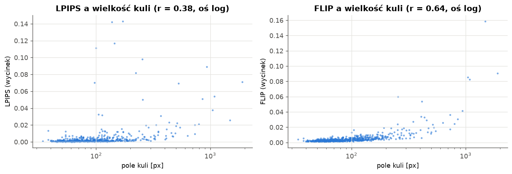

5. **Najgorsze przypadki są ciekawe.** Najwyższy LPIPS dają sceny ze światłem
   **za kulą**. Wtedy referencja OpenGL ma na brzegu sylwetki pojedyncze
   jasne piksele: aliasing przy rasteryzacji odbłysku pod kątem prawie
   stycznym. Sieć rysuje zamiast nich gładki, ciągły pierścień. Z punktu
   widzenia fizyki to raczej *lepszy* obraz, ale metryki porównujące z
   referencją karzą go jako błąd.

   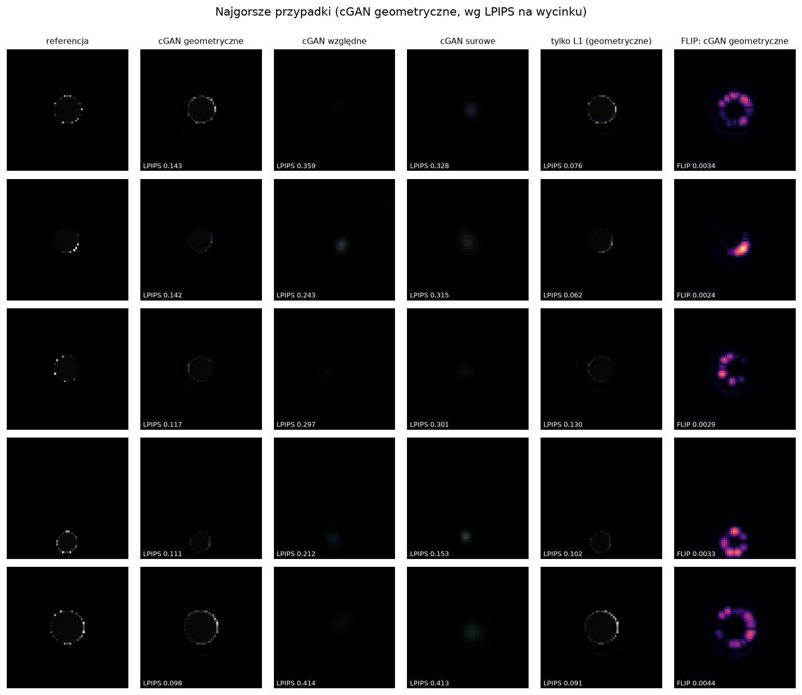

### 5.1 Kiedy GAN pomaga? GAN v2 vs regresja L1

Aby odpowiedzieć uczciwie, dla każdego kodowania trenujemy **tę samą sieć z tą
samą stratą rekonstrukcji**: raz z dyskryminatorem, raz bez (`*_l1`). Obie
sieci oceniamy na tych samych 600 obrazach testowych. Różnice są **parami**
(ten sam obraz), więc ich istotność sprawdzamy testem Wilcoxona
(`scripts/compare_gan.py`, wynik w `results/gan_vs_l1.md`). Oprócz metryk z
zadania mierzymy **ostrość**: stosunek wariancji laplasjanu predykcji do
wariancji laplasjanu referencji na wycinku 64×64. Wartość 1 oznacza taką samą
ilość szczegółów, wartość < 1 rozmycie.

| Kodowanie | Metryka (wycinek) | cGAN | tylko L1 | GAN lepszy / gorszy (% obrazów) | p |
|---|---|---|---|---|---|
| **względne (camera), v2** | FLIP ↓ | **0,0163** | 0,0206 | 82 / 18 | 8·10⁻⁶⁹ |
| | LPIPS ↓ | **0,0738** | 0,0849 | 78 / 22 | 5·10⁻⁴³ |
| | SSIM ↑ | **0,960** | 0,936 | 83 / 17 | 4·10⁻⁷¹ |
| | ostrość → 1 | **0,121** | 0,086 | 87 / 13 | < 10⁻¹⁰⁰ |
| | Hausdorff ↓ (cały kadr) | 6,23 | 6,19 | 20 / 32 | 1·10⁻⁴ |
| **surowe (raw), v1** | FLIP ↓ | **0,0215** | 0,0249 | 80 / 20 | 3·10⁻⁵¹ |
| | LPIPS ↓ | **0,1205** | 0,1331 | 71 / 29 | 8·10⁻²⁸ |
| | SSIM ↑ | **0,946** | 0,930 | 78 / 22 | 1·10⁻⁴⁶ |
| | ostrość → 1 | **0,078** | 0,062 | 74 / 26 | 2·10⁻³⁵ |
| **geometryczne, v2** | FLIP ↓ | 0,0057 | 0,0056 | 48 / 52 | 0,38 |
| | LPIPS ↓ | 0,0045 | **0,0041** | 42 / 58 | 1·10⁻⁵ |
| | SSIM ↑ | **0,9959** | 0,9955 | 57 / 43 | 2·10⁻⁶ |
| | ostrość → 1 | 0,916 | 0,921 | 54 / 46 | 0,07 |

Pełna tabela (także GAN v1 przy kodowaniu względnym i GAN v2 przy surowym)
jest w `results/gan_vs_l1.md`. Względną zmianę każdej metryki pokazuje rysunek:

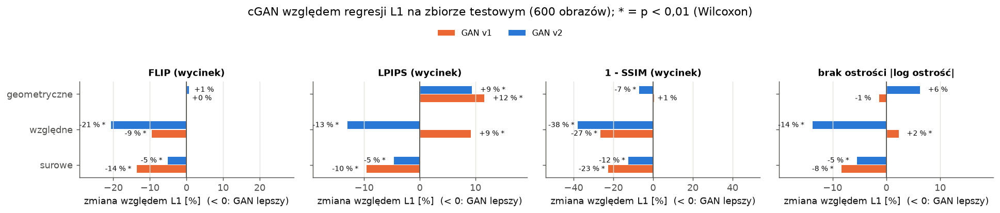

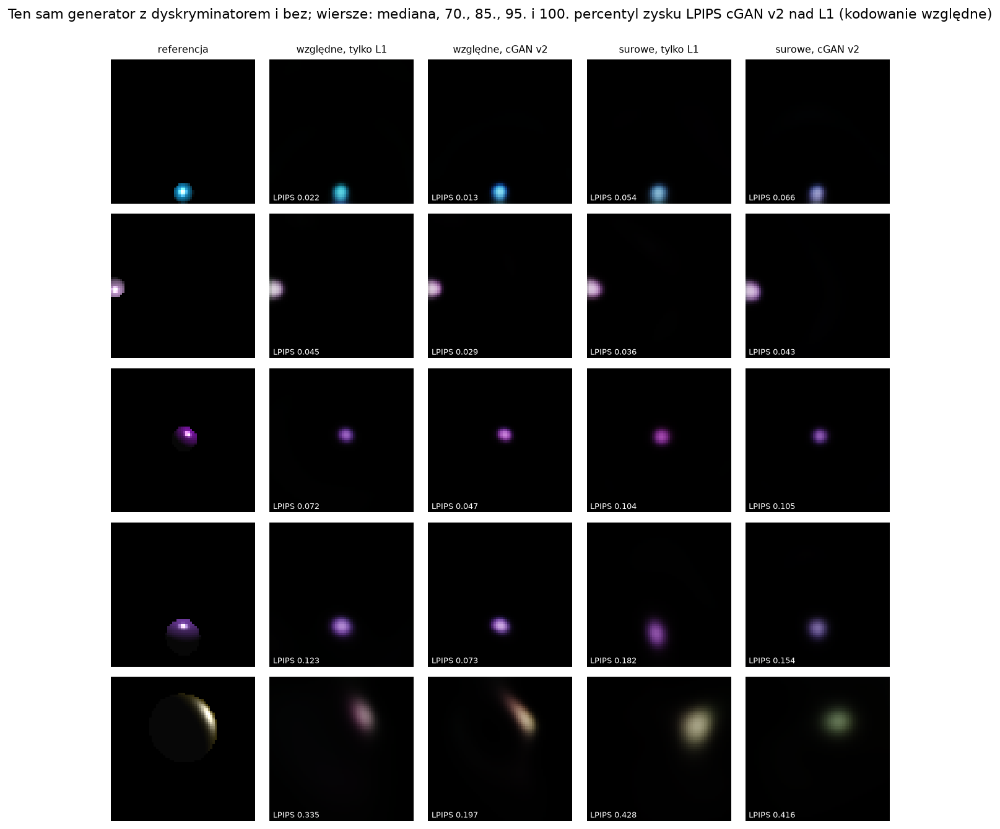

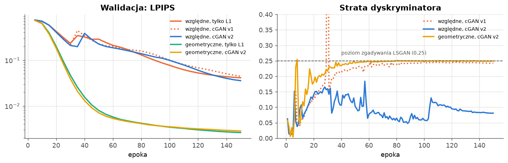

**Wnioski z porównania:**

1. **Gdy regresja jest niepewna, GAN pomaga.** Przy kodowaniu względnym i
   surowym sieć nie umie dokładnie wyznaczyć położenia i kształtu kuli z
   samego wektora parametrów. Strata L1/MSE w takiej sytuacji uśrednia
   możliwe odpowiedzi: kula wychodzi rozmyta (ostrość 0,06–0,09), a na tle
   zostaje słaba „mgła”. GAN v2 przy kodowaniu względnym poprawia FLIP o 21%,
   LPIPS o 13% i (1 − SSIM) o 38%. Kula ma o 40% więcej szczegółów, a różnica
   jest istotna na 78–87% obrazów. Na rysunku z wycinkami GAN rysuje
   wyraźniejszy rozbłysk i ostrzejszą granicę cienia.
2. **Część zysku to czystsze tło.** Przy L1 z kodowaniem względnym 0,92%
   pikseli tła (dalej niż 4 px od kuli) ma jasność > 2/255, a przy GAN v2 tylko
   0,27%. Dyskryminator łatwo rozpoznaje taką mgłę, bo w prawdziwych obrazach
   tło jest idealnie czarne. Dlatego regresja L1 przy kodowaniu względnym ma
   FLIP na całym kadrze **gorszy niż czarny obraz** (0,0081 vs 0,0072), a GAN
   v2 nie (0,0050).
3. **Hausdorff nie pokazuje przewagi GAN-a.** Średnie są równe (6,23 vs
   6,19 px), a mediana jest nawet trochę gorsza (2,8 vs 2,2 px). Ostrzejsza
   kula ma wyraźniejszą krawędź, więc gdy położenie jest lekko błędne, Canny
   wykrywa krawędź w złym miejscu. Rozmyta kula częściej daje krawędź „w
   środku” niepewności. To klasyczny kompromis **percepcja–zniekształcenie**.
4. **Przy kodowaniu geometrycznym GAN nie ma czego poprawiać.** Generator
   dostaje sylwetkę wprost i odtwarza obraz prawie idealnie (ostrość 0,92). D
   nie znajduje różnic i jego strata wraca do 0,25 (rys. krzywych). Różnice
   GAN–L1 są tu rzędu kilku procent, w różne strony (LPIPS lepszy dla L1, SSIM
   dla GAN), więc w praktyce warianty są równoważne. W środkowej fazie uczenia
   (epoki 20–50) GAN v2 był lepszy o ok. 10% LPIPS, ale przewaga zanikła.
5. **v2 vs v1.** Przy kodowaniu względnym poprawki z rozdz. 3.4 zmieniły GAN z
   gorszego od L1 w LPIPS (+9%) na lepszy (−13%). D v2 przez cały trening
   odróżnia obrazy (strata 0,05–0,15 zamiast 0,25). Przy surowym kodowaniu
   lepszy okazał się v1. Każdy wariant trenowaliśmy **tylko raz** (jedno
   ziarno), a p-wartości opisują zmienność po obrazach testowych, nie po
   powtórzeniach treningu. Różnice rzędu kilku procent między v1 i v2 mogą więc
   wynikać z losowości treningu. Duże, spójne efekty z punktów 1–2 raczej nie.

## 6. Czy metryki dobrze oddają jakość?

Krótko: **nie wszystkie i nie w każdych warunkach.** Żeby to sprawdzić,
zastosowaliśmy do 150 obrazów referencyjnych kontrolowane zniekształcenia o
znanej szkodliwości dla oglądającego (`scripts/metric_study.py`).

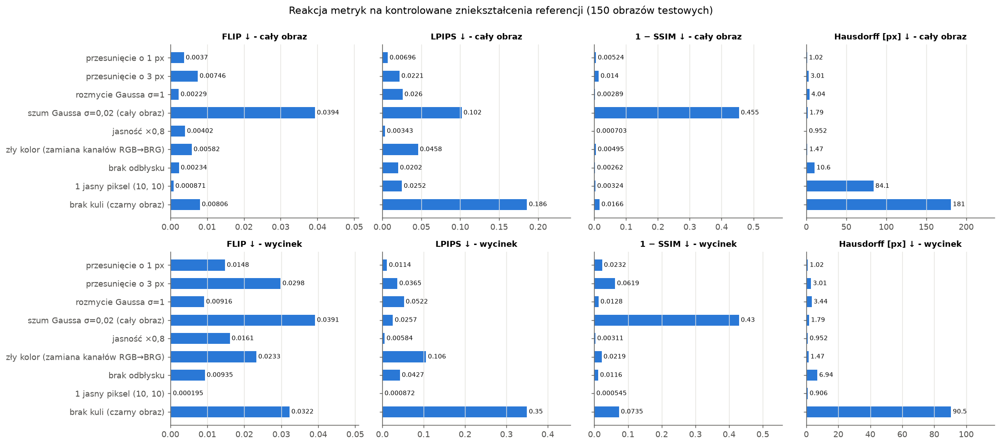

| Zniekształcenie (cały kadr) | FLIP ↓ | LPIPS ↓ | SSIM ↑ | Hausdorff [px] ↓ |
|---|---|---|---|---|
| przesunięcie o 1 px | 0,0037 | 0,0070 | 0,9948 | 1,02 |
| przesunięcie o 3 px | 0,0075 | 0,0221 | 0,9860 | 3,01 |
| rozmycie Gaussa σ=1 | 0,0023 | 0,0260 | 0,9971 | 4,04 |
| szum Gaussa σ=0,02 (cały kadr, ledwo widoczny) | 0,0394 | 0,1019 | **0,5452** | 1,79 |
| jasność ×0,8 | 0,0040 | 0,0034 | 0,9993 | 0,95 |
| zły kolor kuli (RGB→BRG) | 0,0058 | 0,0458 | 0,9951 | 1,47 |
| brak odbłysku | 0,0023 | 0,0202 | 0,9974 | 10,56 |
| 1 jasny piksel w tle | 0,0009 | 0,0252 | 0,9968 | **84,11** |
| **brak kuli (czarny obraz)** | 0,0081 | 0,1859 | **0,9834** | 181,02 |

**SSIM.** Na tych danych SSIM jest najsłabszą metryką:

* czarny obraz bez kuli dostaje **0,985**, tyle samo co wariant `raw` (0,985) i
  prawie tyle co `camera` (0,986);
* niewidoczny szum σ = 0,02 obniża SSIM do 0,55, czyli **27× mocniej** niż
  zniknięcie obiektu.

Przyczyna: SSIM uśrednia lokalne podobieństwo struktury po całym kadrze, a tło
to 99% pikseli. Do tego składnik kontrastu i struktury jest bardzo czuły na
szum na płaskim, czarnym tle (mianownik bliski zeru). SSIM też prawie nie
zauważa zmian jasności (×0,8 daje 0,9993) i koloru, bo liczy osobno każdy kanał i
porównuje głównie strukturę.

**FLIP** to metryka percepcyjna stworzona do renderingu i dla błędów na samym
obiekcie ma sensowną kolejność. Jako *średnia* po pikselach zależy jednak
od tego, jaką część kadru zajmuje obiekt. Brak całej kuli daje 0,008, mniej niż
niewidoczny szum (0,039). Zły kolor kuli (0,0058) wychodzi tylko trochę gorzej
niż przesunięcie o 3 px (0,0075). Mapa błędu FLIP (rys. porównania) bardzo
dobrze pokazuje, *gdzie* jest błąd. Pojedyncza średnia dla małego obiektu na
pustym tle jest jednak mało czuła.

**LPIPS** najlepiej zgadza się z oceną człowieka: brak kuli 0,186 ≫ szum 0,10 >
zły kolor 0,046 > rozmycie i przesunięcie, a zmiana jasności prawie nic nie
kosztuje. Tylko LPIPS wyraźnie odróżnia słabe sieci od czarnego obrazu
(0,055 vs 0,18). Słabości:

* pojedynczy jasny piksel w tle (0,025) jest oceniany gorzej niż brak
  rozbłysku (0,020);
* jest ślepy na niektóre błędy fotometryczne (jasność ×0,8: 0,003);
* wymaga sieci CNN trenowanej na zdjęciach naturalnych, a nie renderach.

**Hausdorff na krawędziach Canny’ego** mierzy wyłącznie geometrię konturów:

* **kolor i jasność są dla niego niewidoczne** (zły kolor 1,5 px, jasność 0,95 px);
* bierze maksimum, więc **jeden zabłąkany piksel** daje 84 px, choć obraz
  jest praktycznie poprawny;
* **nie jest określony**, gdy któryś obraz nie ma krawędzi. Dotyczy to ciemnych
  lub rozmytych kul, które Canny z progami 50/150 pomija: 16 obrazów `camera`
  i 34 `raw`. Wartość zastępcza (181 px) dominuje wtedy średnią. Bez tych
  obrazów średnia `raw` spada z 13,5 do 3,5 px;
* wynik zależy od progów Canny’ego i od tego, czy krawędź wewnętrzna (granica
  cienia, obrys rozbłysku) zostanie wykryta;
* mierzy w pełnych pikselach, więc dla dobrych modeli prawie zawsze wychodzi 1 px.

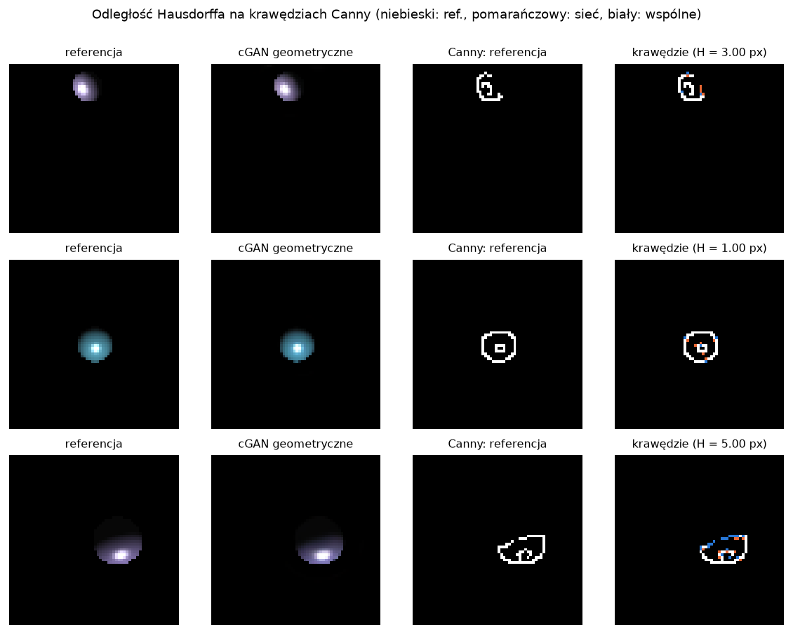

Ma jednak zaletę: tylko on wprost karze **brak lub rozmycie konturu**
(czarny obraz: 181 px; brak odbłysku: 10,6 px, bo znika krawędź rozbłysku).

**Wszystkie metryki z referencją** przyjmują, że referencja jest idealna.
Rasteryzowana siatka ma aliasing na sylwetce i pojedyncze piksele odbłysku
(rozdz. 5, obserwacja 5). Metryki karzą sieć za gładszy, „ładniejszy” wynik.

**Zgodność metryk dla obrazów testowych** (`geometric_gan`, korelacja Spearmana):

| | LPIPS | SSIM | Hausdorff |
|---|---|---|---|
| FLIP | 0,62 | −0,67 | 0,36 |
| LPIPS | | −0,78 | 0,44 |
| SSIM | | | −0,46 |

FLIP, LPIPS i SSIM są ze sobą umiarkowanie zgodne. Hausdorff mierzy co
innego, czyli samą geometrię.

**Zalecenia:**

1. liczyć metryki na **wycinku wokół obiektu** albo z maską;
2. podawać **LPIPS i FLIP** razem z mapą błędu FLIP;
3. Hausdorff traktować tylko jako miarę geometrii i podawać go z **medianą**
   oraz liczbą przypadków nieokreślonych;
4. SSIM na obrazach z dominującym, jednolitym tłem jest mylący.

## 7. Wnioski

* Zbudowaliśmy działający **neuralny renderer modelu Phonga**: warunkowy GAN
  połączony z dostarczonym rendererem OpenGL. Na 600 obrazach testowych
  osiąga FLIP 0,0014, LPIPS 0,0022, SSIM 0,999 i Hausdorffa 2,05 px (mediana
  1 px). Wizualnie wyniki są praktycznie nieodróżnialne od referencji.
* **Sposób zapisania parametrów decyduje o wyniku** (wskazówka 1). Przejście z
  surowych współrzędnych świata na parametry względne kamery i obiektu daje
  poprawę. Podanie analitycznej mapy sylwetki (q) zmniejsza LPIPS na kuli 20–26×
  przy tej samej sieci i tym samym czasie treningu.
* **Surowe przedziały losowania dopuszczają sceny zdegenerowane** (wskazówka
  2): ok. 80% scen bez kuli w kadrze, a także światło lub kamera wewnątrz
  kuli. Losowanie z odrzucaniem usuwa je i zachowuje losowe położenie kuli w
  kadrze (wskazówki 3 i 4).
* **Małe obiekty i strata L1 tworzą pułapkę „czarnego obrazu”**, z której
  wyprowadza dopiero składnik MSE na obszarze kuli.
* **GAN pomaga tam, gdzie regresja jest niepewna.** Przy kodowaniu względnym
  poprawiony cGAN (maskowana strata adwersarialna + feature matching) pokonuje
  regresję L1 na 78–87% obrazów testowych: FLIP −21%, LPIPS −13%, kula ostrzejsza
  o 40%, tło bez „mgły”. Warunkiem jest dyskryminator, który faktycznie widzi
  mały obiekt: bez maski utknął na poziomie zgadywania. Przy kodowaniu
  geometrycznym zadanie jest praktycznie rozwiązane przez samą stratę
  rekonstrukcji, więc GAN nie ma czego poprawiać. Dobre kodowanie wejścia daje
  dużo więcej (20× LPIPS) niż strata adwersarialna (≈ 1,15×).
* **Nie wszystkie metryki dobrze oddają jakość.** SSIM i średni FLIP na całym
  kadrze nie odróżniają braku obiektu od słabego renderu, bo dominuje tło.
  Hausdorff jest ślepy na kolor i bardzo czuły na pojedyncze piksele. LPIPS
  najlepiej zgadza się z oceną wizualną. Wszystkie metryki traktują referencję
  jako idealną, choć sama ma aliasing.

## 8. Odtworzenie wyników

```bash
just sync            # uv sync (torch z CUDA 12.8)
just dataset         # 3000 scen z renderera (headless) -> data/dataset
just train-all       # 4 warianty (~2 h na RTX 5060 Ti)
just train-v2        # GAN v2 + warianty L1 (rozdz. 5.1, ~2 h, 2 treningi równolegle)
just evaluate        # results/summary.csv, results/table.md
just compare-gan     # results/gan_vs_l1.{csv,md} + docs/figures/gan_vs_l1_*.png
just metric-study    # results/metric_study.{csv,md}
just figures         # docs/figures/*.png
just demo            # okno: referencja | sieć | mapa FLIP (nowa scena co 1,5 s)
just demo-headless   # to samo bez okna -> results/demo/
```
